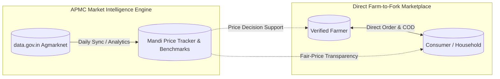
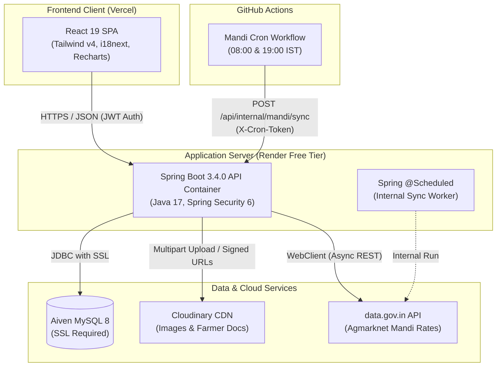
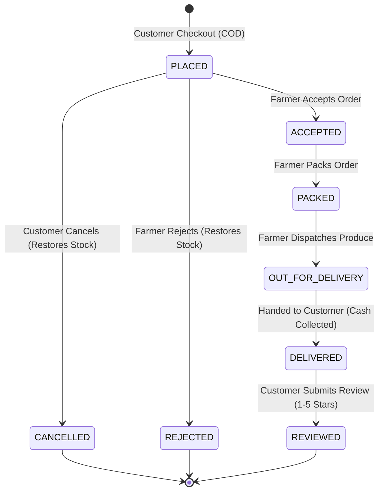
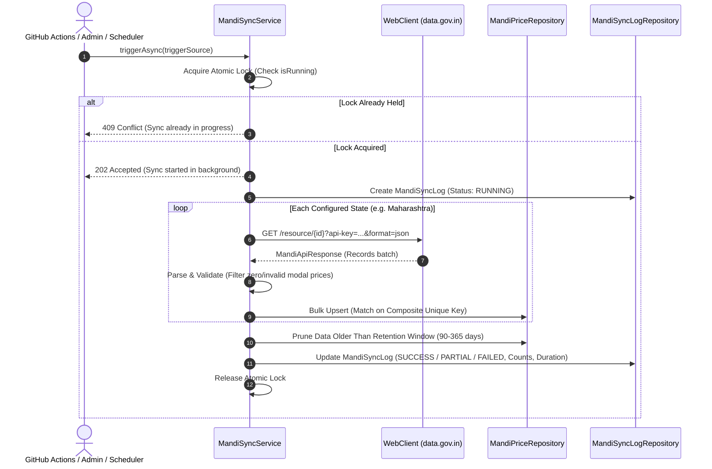

<div align="center">

# 🌾 KisanMandi
### Production-Grade Agri-Commerce & Real-Time APMC Market Intelligence Platform

<p align="center">
  <strong>Bridging Bharat's agricultural divide by connecting rural farmers directly to local consumers while democratizing daily wholesale price transparency.</strong>
</p>

<p align="center">
  KisanMandi is an open-source, full-stack enterprise ecosystem engineered to dismantle multi-tiered intermediary exploitation across India’s agricultural supply chain. Built on a high-throughput <strong>Spring Boot 3 (Java 17)</strong> backend and a modern <strong>React 19 (Tailwind v4)</strong> frontend, the platform pairs an autonomous <strong>farm-to-doorstep marketplace</strong> with a live <strong>APMC wholesale price analytics engine</strong> powered by official Government of India Open Data (Agmarknet).
</p>

<p align="center">
  🚜 <strong>Zero Middlemen</strong> &nbsp;•&nbsp;
  📊 <strong>Live Mandi Rates</strong> &nbsp;•&nbsp;
  📍 <strong>Hyperlocal Geo-Matching</strong> &nbsp;•&nbsp;
  📦 <strong>Atomic Stock & COD</strong> &nbsp;•&nbsp;
  🌐 <strong>English • हिंदी • मराठी</strong>
</p>

<br />

<p align="center">
  <!-- Backend & Core Architecture -->
  <a href="https://www.oracle.com/java/"></a>
  <a href="https://spring.io/projects/spring-boot"></a>
  <a href="https://spring.io/projects/spring-security"></a>
  <a href="https://spring.io/projects/spring-data-jpa"></a>
  <a href="https://hibernate.org/"></a>
  <a href="https://maven.apache.org/"></a>
</p>

<p align="center">
  <!-- Frontend & UI Engineering -->
  <a href="https://react.dev/"></a>
  <a href="https://vite.dev/"></a>
  <a href="https://tailwindcss.com/"></a>
  <a href="https://www.javascript.com/"></a>
  <a href="https://recharts.org/"></a>
  <a href="https://www.i18next.com/"></a>
  <a href="https://axios-http.com/"></a>
  <a href="https://lucide.dev/"></a>
</p>

<p align="center">
  <!-- Database, Cloud & Integrations -->
  <a href="https://www.mysql.com/"></a>
  <a href="https://aiven.io/mysql"></a>
  <a href="https://cloudinary.com/"></a>
  <a href="https://data.gov.in/"></a>
  <a href="https://jwt.io/"></a>
  <a href="https://swagger.io/"></a>
</p>

<p align="center">
  <!-- DevOps, Testing & Deployment -->
  <a href="https://www.docker.com/"></a>
  <a href="https://github.com/features/actions"></a>
  <a href="https://render.com/"></a>
  <a href="https://vercel.com/"></a>
  <a href="https://junit.org/junit5/"></a>
  <a href="https://vitest.dev/"></a>
  <a href="https://www.postman.com/"></a>
  <a href="LICENSE"></a>
</p>

<p align="center">
  <a href="LIVE_URL_HERE"><strong>🚀 Explore Live Demo</strong></a> &nbsp;&nbsp;|&nbsp;&nbsp;
  <a href="API_URL_HERE"><strong>📑 Interactive Swagger API</strong></a> &nbsp;&nbsp;|&nbsp;&nbsp;
  <a href="DEMO_VIDEO_URL_HERE"><strong>🎬 Watch Video Walkthrough</strong></a>
</p>

</div>

---

## Table of Contents
1. [The Problem](#the-problem)
2. [The Solution & Key Features](#the-solution--key-features)
3. [What Makes KisanMandi Unique](#what-makes-kisanmandi-unique)
4. [Screenshots](#screenshots)
5. [Tech Stack](#tech-stack)
6. [Architecture & System Flow](#architecture--system-flow)
7. [Entity Relationship (ER) Model](#entity-relationship-er-model)
8. [Project Structure](#project-structure)
9. [API Overview & Role Permissions](#api-overview--role-permissions)
10. [Getting Started Locally](#getting-started-locally)
11. [Environment Variables](#environment-variables)
12. [Running Tests](#running-tests)
13. [Production Deployment & Caveats](#production-deployment--caveats)
14. [Demo Accounts](#demo-accounts)
15. [Data Source & Attribution](#data-source--attribution)
16. [Known Limitations & Future Scope](#known-limitations--future-scope)
17. [Author & License](#author--license)

---

## The Problem

Agriculture forms the economic and social bedrock of India, sustaining over 40% of the national workforce. Yet, smallholder and marginal farmers—who cultivate less than two hectares of land and represent more than 85% of all agricultural holdings—face severe systemic bottlenecks that depress rural livelihoods while inflating consumer costs:

```
[ Farm Gate ] ──> [ Village Aggregator ] ──> [ Commission Agent (Arhtiya) ] ──> [ Wholesale Mandi ]
                                                                                        │
[ Retail Consumer ] <── [ Neighborhood Vendor ] <── [ Secondary Sub-Wholesaler ] <──────┘
```

### 1. Multi-Tiered Middlemen Dependency & The Value Capture Paradox
Between the farm gate and the urban dinner table lies an entrenched chain of intermediaries: village aggregators (*Kaccha Arhtiyas*), wholesale commission agents (*Pucca Arhtiyas*), transport syndicates, secondary sub-wholesalers, and neighborhood vendors.
- **Extreme Margin Erosion**: At every interchange, fees for loading, unloading, weighing, commission, and transit markups compound. The primary producer often captures only a fraction of the consumer rupee, despite bearing 100% of the financial and climate risk (weather volatility, pest attacks, surging seed and fertilizer costs).
- **Consumer Markups**: Urban and semi-urban households pay steep retail prices for produce that has doubled or tripled in nominal cost solely due to intermediation margins.

### 2. Cold-Chain Deficits, Transit Latency & Post-Harvest Spoilage
India experiences substantial annual post-harvest horticultural losses due to fractured logistics and a lack of localized pre-cooling infrastructure:
- **Prolonged Travel Windows**: Perishable vegetables (tomatoes, spinach, coriander, okra) and fruits spend 48 to 72+ hours moving through hot, congested transit corridors and open-air auction yards.
- **Physical & Nutritional Depreciation**: Extended transit without climate-controlled storage causes rapid moisture loss, nutrient degradation, microbial decay, and handling damage. Produce reaches the end consumer stale, while tons of harvested crops rot before sale.

### 3. Severe Information Asymmetry & The Distress Sale Trap
Market intelligence at the farm gate is historically fragmented:
- **Price Opacity**: Farmers harvest perishable commodities with little to no visibility into real-time modal rates across surrounding district APMC (*Agricultural Produce Market Committee*) mandis.
- **Distress Selling**: Middlemen exploit this information void. During peak arrivals and bumper harvests, local buyers quote below-market rates under the threat that perishable produce cannot be held overnight. Lacking on-site cold storage or alternative channels, farmers are coerced into accepting fire-sale rates.

### 4. Quality Commoditization & Absence of Direct Feedback
- **Bulk Pooling**: Farmers who invest in organic compost, reduced chemical pesticides, or careful grading are forced to dump their produce into generic auction heaps. The identity of their harvest is erased, and quality premiums are lost.
- **Zero Consumer Relationship**: The traditional supply chain completely severs the link between the grower and the consumer, preventing farmers from establishing brand equity, loyal recurring buyers, or direct reputation feedback.

---

### Supply Chain Comparison Matrix

| Dimension | Traditional APMC Multi-Tiered Chain | KisanMandi Direct Model |
| :--- | :--- | :--- |
| **Intermediary Layers** | 4 to 6 Tiers (Aggregator, Arhtiya, Wholesaler, Vendor) | **0 Tiers (Direct Farm-to-Consumer)** |
| **Farmer Price Share** | Heavily diminished by multi-tier commission cuts | **100% of Listed Produce Price** |
| **Farm-to-Fork Latency** | 48 to 72+ Hours via central yards | **Same-Day / Next-Day Direct Dispatch** |
| **Produce Freshness** | High transit spoilage & nutritional loss | **Direct Harvest-to-Doorstep Freshness** |
| **Price Discovery** | Opaque verbal bargaining & local cartel pricing | **Real-Time Government APMC Price Benchmarks** |
| **Product Identity** | Anonymized bulk pooling at auction yards | **Verified Farm Storefront & Direct Reputation** |
| **Payment Friction** | Delayed settlement & intermediary credit cycles | **Immediate Cash on Delivery (COD)** |

---

## The Solution & Key Features

KisanMandi resolves these systemic supply-chain failures through a unified **dual-engine digital platform**:
1. **Direct Farm-to-Fork Hyperlocal Marketplace**: A peer-to-peer e-commerce bridge connecting verified local agricultural producers with nearby households and bulk consumers.
2. **Real-Time APMC Mandi Intelligence Engine**: An automated data pipeline ingesting daily arrivals, minimum, maximum, and modal wholesale rates from 30+ government APMC mandis across India via the official `data.gov.in` (Agmarknet) API.



---

### Features by User Role

#### 1. Customer (Consumer / Household Buyer)
- **Direct Farm Discovery & Origin Transparency**: Browse freshly harvested produce directly from verified growers in your region. View farm background, location details, and authentic farmer profiles before purchasing.
- **Zero-Cost Hyperlocal Geo-Discovery**: Search for nearby farmers and available crops using client-side GPS coordinates. Distance is computed dynamically via an in-database spherical Haversine formula (`6371 * acos(...)`), eliminating costly third-party map API dependencies while delivering accurate radial search within 5 km to 50 km.
- **Multidimensional Catalog Filtering**: Search produce with granular multi-facet filters:
  - Commodity category pills (Vegetables, Fruits, Grains, Pulses, Dairy, Spices)
  - Price-range sliders (₹/kg or ₹/quintal)
  - Real-time stock availability toggles
  - Minimum farmer star rating thresholds
- **Flexible Cart & Multi-Address Book**:
  - Save multiple delivery addresses (Home, Office, Alternate) with default selection.
  - Cart state machine recalculates item totals, validates live stock limits, and handles single-farmer order clarity.
- **Transparent Cash on Delivery (COD) Checkout**: Built for mainstream Indian household convenience—no upfront card payments or payment gateway drop-offs. Pay upon physical delivery and inspection.
- **Interactive 5-Stage Visual Order Stepper**: Monitor order progression in real time with a color-coded visual tracking pipeline:
  $$\text{PLACED} \longrightarrow \text{ACCEPTED} \longrightarrow \text{PACKED} \longrightarrow \text{OUT\_FOR\_DELIVERY} \longrightarrow \text{DELIVERED}$$
  Customers retain the ability to cancel an order before the farmer accepts and begins packing.
- **Verified Closed-Loop Reviews & Ratings**: Anti-fraud review mechanism where ratings (1 to 5 stars) and qualitative feedback can **only** be submitted after an order has reached `DELIVERED` status, safeguarding farmer reputations against Sybil attacks and unverified reviews.
- **Frictionless Trilingual Localization**: Instant client-side language switching between English, conversational spoken Hindi (*आम बोलचाल की हिंदी*), and Marathi (*मराठी*). Powered by `i18next` and native Devanagari typography, retaining natural agrarian loanwords (*mandi*, *quintal*, *aadath*, *kisan*, *order*).

---

#### 2. Farmer (Agricultural Producer & FPO)
- **Digital Farm Onboarding & KYC Identity Verification**:
  - Register with complete farm metadata: Farm Name, Bio, Village, Taluka/Tehsil, District, State, PIN Code, and GPS Latitude/Longitude coordinates.
  - Upload land ownership documents (7/12 extract, Patta) or government identity cards (Aadhaar, Kisan Credit Card) securely to Cloudinary for platform admin verification.
- **Flexible Crop Catalog & Unit Economics**:
  - List seasonal produce with high-resolution photos, harvest dates, and descriptions.
  - Dual-unit pricing architecture: Set retail prices in **₹/kg** (for vegetables and fruits) or wholesale prices in **₹/quintal** (for grains and pulses) with automated mathematical conversions (1 Quintal = 100 kg).
- **Real-Time Atomic Inventory Management**:
  - Real-time stock counters that decrement automatically upon confirmed buyer checkout reservations.
  - Synchronized database updates prevent overselling during simultaneous checkout attempts, with automated inventory restock if an order is cancelled or rejected.
- **Operational Dispatch Queue & Order Management**:
  - Live incoming order queue displaying customer name, contact details, item breakdown, and delivery address.
  - Actionable status transitions: **Accept**, **Pack**, **Dispatch**, **Deliver**, or **Reject** (with required rejection explanation).
- **Real-Time APMC Mandi Price Benchmarking**:
  - Integrated market intelligence widget directly inside the crop creation form and dashboard.
  - Farmers can view current modal and wholesale price trends from their local district APMC mandi before listing produce, ensuring they price competitively without leaving money on the table.
- **Live Revenue Analytics & Financial Telemetry**:
  - Visual metrics dashboard tracking Gross Merchandise Value (GMV), completed deliveries, pending dispatch queue, and customer review aggregates.
- **Dedicated Public Farm Storefront**:
  - Shareable digital farm profile URL showcasing the farmer's verification badge, biography, farm location, active crop inventory, and verified buyer reviews.

---

#### 3. Platform Administrator (Operations & Compliance)
- **Strict Farmer Verification & KYC Compliance**:
  - Review submitted farmer onboarding applications with one-click access to uploaded land and identity documents.
  - Documents are viewed via secure, time-limited signed Cloudinary URLs, preventing public indexation of sensitive personal identification records.
  - Approve or reject applications with mandatory administrative audit notes.
- **Catalog Taxonomy & Category Governance**:
  - Centrally manage marketplace commodity categories (Vegetables, Fruits, Grains, Pulses, Dairy, Spices, Organic).
  - Create, update, or toggle category visibility platform-wide.
- **Trust, Safety & User Account Moderation**:
  - Inspect user accounts across all roles (`CUSTOMER`, `FARMER`, `ADMIN`).
  - Temporarily block or reactivate accounts violating community guidelines, fair trade practices, or delivery commitments.
- **Content Moderation & Dispute Audit Trails**:
  - Audit and moderate flagged produce listings or spam customer reviews.
  - Mandatory audit reason logging ensures complete operational accountability.
- **Platform-Wide KPI & GMV Telemetry**:
  - Executive dashboard monitoring aggregate user counts, verified farmer counts, total order throughput, Gross Merchandise Value (GMV), and daily platform growth.
- **Automated Mandi Sync Operations**:
  - Monitor daily automated Agmarknet data ingestion runs, inspection logs, error states, and records upserted.
  - Trigger immediate on-demand manual sync runs via the admin interface with real-time sync progress feedback.

---

### Features by Technical Module

```
┌────────────────────────────────────────────────────────────────────────────────────────┐
│                                 KISANMANDI CORE MODULES                                │
├──────────────────────────┬─────────────────────────────┬───────────────────────────────┤
│    SECURITY & ACCESS     │      COMMERCE ENGINE        │      DATA INTELLIGENCE        │
├──────────────────────────┼─────────────────────────────┼───────────────────────────────┤
│ • Stateless JWT Bearer   │ • 5-Stage Order State Mach. │ • Spring WebClient Reactive   │
│ • Role-Based RBAC        │ • Atomic Inventory Reserve  │ • Bulk Upsert & Deduplication │
│ • Sliding-Window Limiter │ • Immutable Past Snapshots  │ • Sleep-Resilient Hybrid Cron │
│ • BCrypt Password Hash   │ • COD Payment Verification  │ • In-DB Haversine Calculation │
└──────────────────────────┴─────────────────────────────┴───────────────────────────────┘
```

#### 1. Stateless Authentication & Granular RBAC
- Built on **Spring Security 6** with stateless JSON Web Tokens (JWT) signed via HMAC-SHA256 (`jjwt 0.12.6`).
- Cryptographic password hashing using **BCrypt** with an adaptive work factor of 10.
- Strict multi-tenant Role-Based Access Control enforcing boundary segregation (`ROLE_CUSTOMER`, `ROLE_FARMER`, `ROLE_ADMIN`) across all API controllers and client routes.

#### 2. Edge Throttling & DDoS Protection
- Custom `RateLimitFilter` utilizing an in-memory sliding-window token bucket algorithm.
- Protects authentication endpoints (`/api/auth/**`) and public search APIs against brute-force attacks, credential stuffing, and scraping bots without adding external Redis overhead.

#### 3. Cloud Media & Secure Document Pipeline
- Multipart file streaming directly to **Cloudinary** via backend service wrappers.
- Segregated storage folders (`kisanmandi/products` for public produce images vs. `kisanmandi/documents` for private KYC records).
- Strict MIME-type whitelisting (JPEG, PNG, WebP, PDF), file size boundaries, and time-limited authenticated access for farmer verification documents.

#### 4. Deterministic Order Finite State Machine (FSM)
- Strict state transition enforcement: An order cannot jump states (e.g., cannot transition directly from `PLACED` to `DELIVERED`).
- Encapsulated within Spring `@Transactional` boundaries to guarantee atomicity: stock is deducted atomically at checkout and automatically refunded if an order is cancelled or rejected.

#### 5. Immutable Financial & Receipt Snapshots
- When an order is placed, delivery address attributes and product line items (product name, unit, unit price at purchase time, product image URL) are deep-copied into dedicated columns in `orders` and `order_items`.
- Subsequent farmer price updates, crop deletions, or customer profile address edits **never mutate historical receipts or financial audits**.

#### 6. Automated APMC Agmarknet Ingestion Pipeline
- Asynchronous, non-blocking HTTP ingestion using Spring Boot `WebClient` interfacing with the official `data.gov.in` Agmarknet API.
- Implements a resilient bulk upsert strategy backed by a composite unique database index:
  $$\text{UNIQUE}(\text{commodity}, \text{state}, \text{district}, \text{market}, \text{arrival\_date})$$
- Automatically dedupes existing records and updates price revisions across repeated runs without database bloat.

#### 7. Sleep-Resilient Hybrid Scheduled Architecture
- **Internal Worker**: Spring `@Scheduled` cron job triggers daily at 08:00 IST and 19:00 IST when containers are running.
- **External Webhook Worker**: A dedicated GitHub Actions workflow (`.github/workflows/mandi-sync.yml`) runs on an external cron schedule, dispatches a wake-up ping, and fires an authenticated HTTP `POST /api/internal/mandi/sync` request with a shared bearer secret. This guarantees sync execution even on free-tier container platforms (such as Render) that enter sleep mode after inactivity.

---

## What Makes KisanMandi Unique

1. **Addresses a Real Socio-Economic Need**: Rather than serving as an elite niche portal, KisanMandi is engineered for real Indian agricultural realities—eliminating exploitative commission agents (*arhtiyas*) and putting price control back into the hands of primary producers.
2. **Live Government Open Data Integration**: Seamless live integration with the official `data.gov.in` Agmarknet API, streaming wholesale arrivals and modal prices across 30+ major mandis into the platform daily.
3. **Zero-Cost In-Database Hyperlocal Discovery**: Solves the geo-discovery challenge through native in-database mathematical spherical geometry (Haversine formula on indexed latitude/longitude columns), delivering accurate radial distance searches without expensive proprietary map API billing.
4. **Rigorous Three-Tier Role-Based Architecture**: Complete architectural segregation between Customers, Farmers, and Platform Administrators across database entities, Spring Security filter chains, and React navigation hierarchies.
5. **Sleep-Resilient Hybrid Cloud Synchronization**: Overcomes the notorious cold-start sleep timeout limitations of free cloud container tiers by pairing internal Spring scheduling with external authenticated headless GitHub Actions webhooks.
6. **Culturally Grounded Conversational Localization**: Thoughtfully translated into spoken conversational Hindi and Marathi using authentic Devanagari typography. Unlike mechanical machine translations, it preserves the natural agricultural loanwords that rural farmers and Indian households use every day (*mandi*, *quintal*, *aadath*, *kisan*, *order*, *login*).

---

## Screenshots

Captured visual walkthroughs of the application are located in [`docs/screenshots/`](docs/screenshots/README.md):

| File | Description | Viewport |
| :--- | :--- | :--- |
| [`01-home.png`](docs/screenshots/README.md) | Marketplace landing page with value proposition and language toggle | Desktop |
| [`02-register-role.png`](docs/screenshots/README.md) | Multi-role registration selector (Farmer vs. Customer) | Desktop |
| [`03-browse-filters.png`](docs/screenshots/README.md) | Product marketplace with category pills and price sliders | Desktop |
| [`04-near-me.png`](docs/screenshots/README.md) | Hyperlocal geo-search with radius slider (Haversine calculation) | Desktop |
| [`05-product-detail.png`](docs/screenshots/README.md) | Crop details, farmer rating badge, and unit pricing | Desktop |
| [`06-cart.png`](docs/screenshots/README.md) | Customer cart with quantity management and delivery calculation | Desktop |
| [`07-checkout.png`](docs/screenshots/README.md) | Delivery address selector and Cash on Delivery confirmation | Desktop |
| [`08-order-tracking.png`](docs/screenshots/README.md) | Visual 5-step order timeline tracking status from Placement to Delivery | Desktop / Mobile |
| [`09-farmer-dashboard.png`](docs/screenshots/README.md) | Farmer portal with live sales metrics, revenue, and active orders | Desktop |
| [`10-add-product.png`](docs/screenshots/README.md) | Crop listing form with Cloudinary image uploader and unit selector | Desktop |
| [`11-incoming-orders.png`](docs/screenshots/README.md) | Incoming order processing queue with dispatch status actions | Desktop |
| [`12-mandi-dashboard.png`](docs/screenshots/README.md) | APMC Mandi tracker with commodity search and Recharts trend graph | Desktop |
| [`13-mandi-mobile.png`](docs/screenshots/README.md) | Mobile responsive Mandi view showing unit toggle (₹/kg vs. ₹/quintal) | Mobile (375px) |
| [`14-reviews.png`](docs/screenshots/README.md) | Verified customer reviews and rolling average ratings | Desktop |
| [`15-admin-dashboard.png`](docs/screenshots/README.md) | Admin platform overview, user counts, and health indicators | Desktop |
| [`16-admin-farmer-approval.png`](docs/screenshots/README.md) | Admin farmer verification queue with document preview | Desktop |
| [`17-swagger.png`](docs/screenshots/README.md) | Springdoc OpenAPI interactive documentation interface | Desktop |
| [`18-hindi-marathi.png`](docs/screenshots/README.md) | Localized interface toggled to Hindi / Marathi | Desktop / Mobile |

---

## Tech Stack

| Domain | Technology | Version | Purpose |
| :--- | :--- | :--- | :--- |
| **Frontend** | React | 19.x | Component-driven user interface |
| | Vite | 6.x | Fast build tooling and hot module replacement |
| | Tailwind CSS | 4.x | Responsive utility styling and typography |
| | Lucide React | Latest | Clean UI iconography |
| | Recharts | 2.x | Historical Mandi price trend and comparison charts |
| | Axios | 1.x | HTTP client with automatic JWT token attachment |
| | i18next | Latest | Multilingual localization (EN, HI, MR) |
| **Backend** | Java | 17 LTS | Core application language |
| | Spring Boot | 3.4.0 | REST API framework, DI container, and scheduling |
| | Spring Security | 6.x | Stateless JWT authentication and RBAC filters |
| | Spring Data JPA | 3.4.0 | ORM database abstraction and repository layer |
| | Spring WebFlux | 3.4.0 | Non-blocking `WebClient` for external API integration |
| | JJWT | 0.12.6 | Cryptographic token creation and validation |
| | Springdoc OpenAPI | 2.7.0 | Swagger UI and OpenAPI 3 schema generation |
| **Database** | MySQL | 8.x | Relational database with composite unique constraints |
| | HikariCP | Default | Optimized database connection pooling |
| **Cloud Services** | Cloudinary | API v2 | Media storage for crop photos and documents |
| | data.gov.in | Agmarknet | Open Government Data API for wholesale rates |
| | Render | Free Tier | Backend Docker container runtime |
| | Vercel | Hobby Tier | Frontend static SPA edge hosting |
| | Aiven | Free Tier | Managed cloud MySQL instance (SSL enforced) |
| | GitHub Actions | Workflows | Continuous Integration and headless daily cron trigger |

---

## Architecture & System Flow

### 1. High-Level System Architecture



### 2. Order Lifecycle State Machine



### 3. APMC Mandi Data Synchronization Flow



---

## Entity Relationship (ER) Model

The database enforces referential integrity, historical snapshots, and composite indexing across 11 primary tables.

Detailed visual schema and design rationale: [**docs/er-diagram.md**](docs/er-diagram.md)

---

## Project Structure

```
KisanMandi/
├── .github/
│   └── workflows/
│       ├── ci.yml                     # Automated Java 17 and Node 20 CI pipeline
│       └── mandi-sync.yml             # Scheduled twice-daily APMC price sync webhook
├── docs/
│   ├── architecture.md               # Technical decisions and layer explanations
│   ├── deployment.md                 # Production deployment guide (Aiven, Render, Vercel)
│   ├── environment-variables.md      # Master environment variables reference
│   ├── api-keys-setup.md             # Guide to obtain Cloudinary and data.gov.in keys
│   ├── er-diagram.md                 # Comprehensive ER diagram and schema design
│   ├── test-cases.md                 # Test suite breakdown, matrix, and granular test cases
│   ├── screenshots/
│   │   └── README.md                 # Exact checklist of the 18 screenshots to capture
│   └── postman/
│       ├── KisanMandi.postman_collection.json         # Postman v2.1 collection (35+ requests)
│       ├── KisanMandi.local.postman_environment.json  # Postman local environment variables
│       └── README.md                 # Postman & Newman execution guide
├── kisanmandi-backend/
│   ├── Dockerfile                    # Multi-stage production container build (Temurin 17 JRE)
│   ├── pom.xml                       # Maven build descriptor (Spring Boot 3.4.0)
│   └── src/
│       ├── main/java/com/kisanmandi/
│       │   ├── config/               # Security, OpenAPI, Cloudinary, Seeder configs
│       │   ├── controller/           # REST controllers (Auth, Products, Cart, Orders, Admin, Mandi)
│       │   ├── dto/                  # Request records and response transfer objects
│       │   ├── entity/               # JPA domain entities (User, Product, Order, MandiPrice)
│       │   ├── exception/            # Custom exceptions and GlobalExceptionHandler
│       │   ├── repository/           # Spring Data JPA repositories
│       │   ├── security/             # JWT filter, UserDetails, and rate limiter
│       │   └── service/              # Core business rules and external integrations
│       └── test/                     # 80 automated unit and integration tests
├── kisanmandi-frontend/
│   ├── package.json                  # Node dependencies (React 19, Vite, Tailwind v4)
│   ├── vercel.json                   # Vercel SPA routing rewrites and asset caching rules
│   ├── scripts/
│   │   └── check-i18n.mjs            # Deterministic translation key parity checker
│   └── src/
│       ├── api/                      # Axios HTTP client with JWT interceptor
│       ├── components/               # Reusable UI components, modals, and charts
│       ├── context/                  # AuthContext and CartContext global state
│       ├── i18n/                     # i18next configuration and language detector
│       ├── locales/                  # English, Hindi, and Marathi dictionaries (447 keys each)
│       ├── pages/                    # Public, Customer, Farmer, and Admin views
│       └── __tests__/                # 41 Vitest and React Testing Library tests
├── .gitattributes                    # Line ending normalization across OS platforms
├── .gitignore                        # Global ignore rules for secrets and build artifacts
├── LICENSE                           # MIT License
└── README.md                         # Project documentation
```

---

## API Overview & Role Permissions

Interactive OpenAPI documentation is generated live via Springdoc. Once the backend is running, open:
`http://localhost:8080/swagger-ui/index.html`

### Endpoint Groups Overview

| Module | Route Prefix | Access Level | Description |
| :--- | :--- | :--- | :--- |
| **Auth** | `/api/auth` | Public | User registration and JWT login |
| **Health** | `/api/health` | Public | System status and database liveness ping |
| **Products** | `/api/products` | Public | Public catalog search, category filters, and detail |
| **Categories** | `/api/categories` | Public | Active commodity categories list |
| **Mandi** | `/api/mandi` | Public | Daily APMC prices, trends, comparisons, and markets |
| **Nearby** | `/api/nearby` | Public | Haversine distance-based local farm search |
| **Customer** | `/api/customer/addresses` | Customer | Address book management |
| | `/api/customer/cart` | Customer | Shopping cart operations |
| | `/api/customer/orders` | Customer | COD checkout, order tracking, and cancellations |
| | `/api/customer/reviews` | Customer | Rating and review submission for delivered orders |
| **Farmer** | `/api/farmer/profile` | Farmer | Farm profile and verification document upload |
| | `/api/farmer/products` | Farmer | Crop listing, stock updates, and soft delete |
| | `/api/farmer/orders` | Farmer | Incoming order processing and status transitions |
| | `/api/farmer/stats` | Farmer | Farmer gross sales and metrics overview |
| | `/api/farmer/reviews` | Farmer | Customer reviews received by the farmer |
| **Admin** | `/api/admin/stats` | Admin | Platform-wide analytics and indicators |
| | `/api/admin/farmers` | Admin | Farmer approvals, rejections, and document inspection |
| | `/api/admin/categories` | Admin | Create and toggle category availability |
| | `/api/admin/users` | Admin | Account blocking and unblocking |
| | `/api/admin/products` | Admin | Moderation hide and unhide for crop listings |
| | `/api/admin/reviews` | Admin | Moderation hide and unhide for reviews |
| | `/api/admin/mandi` | Admin | Mandi sync execution logs and manual sync trigger |
| **Internal** | `/api/internal/mandi/sync` | `X-Cron-Token` | Headless sync webhook for external schedulers |

---

### Role & Permission Matrix

| Operation | Public | Customer | Farmer | Admin |
| :--- | :---: | :---: | :---: | :---: |
| Browse Marketplace Products | ✅ | ✅ | ✅ | ✅ |
| Search APMC Mandi Rates & Trends | ✅ | ✅ | ✅ | ✅ |
| Register as Customer / Farmer | ✅ | ❌ | ❌ | ❌ |
| Manage Cart & Place Orders (COD) | ❌ | ✅ | ❌ | ❌ |
| Submit Review for Delivered Order | ❌ | ✅ | ❌ | ❌ |
| List Produce & Manage Crop Inventory | ❌ | ❌ | ✅ *(Approved)* | ❌ |
| Process Incoming Orders & Change Status | ❌ | ❌ | ✅ | ❌ |
| Approve / Reject Farmer Applications | ❌ | ❌ | ❌ | ✅ |
| Block Users & Moderate Products/Reviews | ❌ | ❌ | ❌ | ✅ |
| Trigger Manual APMC Mandi Sync | ❌ | ❌ | ❌ | ✅ |

---

## Getting Started Locally

### Prerequisites
- **JDK 17** LTS installed ([Eclipse Temurin](https://adoptium.net/) recommended)
- **Node.js 20+** and `npm` installed
- **MySQL 8.x** running locally on port `3306`
- **Git**

---

### Step 1: Clone and Prepare Database

```powershell
# Clone the repository
git clone https://github.com/kasimshah19/kisanmandi.git
cd kisanmandi

# Log into MySQL and create the local database
mysql -u root -p -e "CREATE DATABASE IF NOT EXISTS kisanmandi_db CHARACTER SET utf8mb4 COLLATE utf8mb4_unicode_ci;"
```

---

### Step 2: Configure Backend Properties

Copy the example configuration file:

```powershell
cd kisanmandi-backend
Copy-Item src/main/resources/application-local.properties.example src/main/resources/application-local.properties
```

Open `src/main/resources/application-local.properties` and configure your credentials:
1. `DB_USERNAME` and `DB_PASSWORD`: Your local MySQL credentials.
2. `JWT_SECRET`: Any random alphanumeric string at least 32 characters long.
3. `APP_ADMIN_EMAIL` and `APP_ADMIN_PASSWORD`: Email and password for the automatically seeded local administrator account.
4. `CLOUDINARY_*` keys: Obtained free from [cloudinary.com](https://cloudinary.com).
5. `MANDI_API_KEY`: Obtained free from [data.gov.in](https://data.gov.in). *(Refer to [docs/api-keys-setup.md](docs/api-keys-setup.md) for step-by-step guidance).*

---

### Step 3: Run the Backend Application

```powershell
# From kisanmandi-backend/
.\mvnw spring-boot:run
```

The Spring Boot backend will start on **`http://localhost:8080`**.
- OpenAPI / Swagger UI: `http://localhost:8080/swagger-ui/index.html`
- Health Endpoint: `http://localhost:8080/api/health`

---

### Step 4: Run the Frontend Application

Open a new PowerShell terminal:

```powershell
cd KisanMandi/kisanmandi-frontend

# Install dependencies
npm install

# Start the Vite development server
npm run dev
```

The React frontend will start on **`http://localhost:5173`**.

---

## Environment Variables

For full variable definitions, production defaults, and platform assignments, refer to:
[**docs/environment-variables.md**](docs/environment-variables.md)

### Key Variables Summary

| Variable | Target Platform | Description |
| :--- | :--- | :--- |
| `SPRING_PROFILES_ACTIVE` | Backend (Render) | Set to `prod` for production deployment |
| `DB_URL` | Backend (Render) | JDBC connection string with SSL enabled |
| `DB_USERNAME` / `DB_PASSWORD` | Backend (Render) | Cloud database credentials |
| `JWT_SECRET` | Backend (Render/Local) | HMAC-SHA secret (minimum 32 characters) |
| `APP_ADMIN_EMAIL` / `APP_ADMIN_PASSWORD` | Backend (Render/Local) | Credentials for bootstrap admin account |
| `CLOUDINARY_CLOUD_NAME` / `API_KEY` / `API_SECRET` | Backend (Render/Local) | Cloudinary media management credentials |
| `MANDI_API_KEY` | Backend (Render/Local) | API key from data.gov.in |
| `APP_CORS_ALLOWED_ORIGINS` | Backend (Render) | Comma-separated allowed frontend origins |
| `MANDI_CRON_TOKEN` | Backend & GitHub Actions | Shared secret token for the sync webhook |
| `VITE_API_BASE_URL` | Frontend (Vercel) | Base API URL pointing to the deployed backend |

---

## Running Tests

Both backend and frontend contain extensive automated test suites with **100% pass rates across 121 tests** running automatically in Continuous Integration (CI) on every push.

### Automated Test Battery Overview

| Layer | Framework & Tools | Scope | Test Count | Pass Rate | Status |
| :--- | :--- | :--- | :--- | :--- | :--- |
| **Backend Service Layer** | JUnit 5, Mockito | Order state machine, stock rollback, cart rules, reviews, Haversine geo calculations | **30 tests** | 100% (30/30) |  |
| **Backend Integration & RBAC** | Spring Boot Test, MockMvc, H2 In-Memory | Multi-tenant RBAC segregation, JWT auth flow, blocked accounts, internal webhook cron security | **17 tests** | 100% (17/17) |  |
| **Backend Security & Config** | JUnit 5, Mockito | Sliding-window IP rate limiting (`RateLimitFilter`), JWT utilities, demo account seeder, prod config validation | **8 tests** | 100% (8/8) |  |
| **Mandi Pipeline & Ingestion** | JUnit 5, Mockito, WebClient Mock | data.gov.in Agmarknet API response parsing, bulk batch upsert, composite unique key deduplication | **25 tests** | 100% (25/25) |  |
| **Frontend i18n & Locales** | Vitest, i18next harness | Translation dictionary parity (447 keys across EN, HI, MR), zero-reload toggle, localStorage, HTML sync | **15 tests** | 100% (15/15) |  |
| **Frontend UI & Components** | Vitest, React Testing Library, jsdom | `PriceUnitToggle` (₹/kg vs. ₹/quintal), `OrderStatusStepper` 5-stage progression, `RatingStars`, `ServerStatusBanner` | **14 tests** | 100% (14/14) |  |
| **Frontend Helpers & Math** | Vitest, jsdom | Client-side Haversine distance, Indian currency formatters (`formatINR`), localized date formatters | **12 tests** | 100% (12/12) |  |
| **Total Test Battery** | **Full Stack Test Suite** | **Comprehensive Domain, Security, Pipeline & UI Coverage** | **121 tests** | **100% (121/121)** |  |

> [!TIP]
> For the complete granular test case specification (with individual test case IDs `TC-BE-ORD-01` through `TC-FE-UTL-03`, input preconditions, expected assertions, and Postman E2E test flows), see:
> [**docs/test-cases.md**](docs/test-cases.md)

---

### Backend Tests (JUnit 5 + Mockito)
```powershell
cd kisanmandi-backend

# Run all 80 unit and integration tests
.\mvnw test

# Run a specific test class
.\mvnw test -Dtest=OrderServiceTest

# Run all integration tests
.\mvnw test -Dtest=*IntegrationTest

# Generate JaCoCo code coverage report
.\mvnw test jacoco:report
```

### Frontend Tests (Vitest + React Testing Library)
```powershell
cd kisanmandi-frontend

# Run all 41 frontend tests
npm test

# Run tests in interactive watch mode
npm run test:watch

# Verify 100% translation key parity across EN, HI, MR
npm run i18n:check

# Validate production build bundle
npm run build
```

---

## Production Deployment & Caveats

KisanMandi is configured for seamless deployment on free-tier infrastructure:
- **Frontend**: Vercel Static SPA ([kisanmandi-frontend/vercel.json](kisanmandi-frontend/vercel.json) rewrites).
- **Backend**: Render Web Service ([kisanmandi-backend/Dockerfile](kisanmandi-backend/Dockerfile) multi-stage build).
- **Database**: Aiven MySQL (Free 1 GB service with SSL).
- **APMC Mandi Cron**: GitHub Actions ([.github/workflows/mandi-sync.yml](.github/workflows/mandi-sync.yml)).

Full deployment walkthrough: [**docs/deployment.md**](docs/deployment.md)

### Free-Tier Cloud Caveats
1. **Render Container Sleep**: Free-tier instances spin down after 15 minutes of inactivity. The first request after sleep can experience a **30 to 60 second cold start**. The frontend includes an automated health check ping and an informative banner (`ServerStatusBanner`) that reassures users during cold starts.
2. **Database Inactivity Limits**: Aiven free-tier databases may pause if left untouched for extended periods. Ensure your daily Mandi sync runs to keep the database active.
3. **Mandi Cron Execution**: Because the backend container sleeps, internal Spring schedulers cannot fire while asleep. The included **GitHub Actions workflow** solves this by sending an HTTP POST webhook twice daily, waking Render and executing the sync.

---

## Demo Accounts

The local database automatically provisions the following default test accounts:

| Role | Email | Password | Access Scope |
| :--- | :--- | :--- | :--- |
| **Customer** | `CUSTOMER_DEMO_EMAIL_HERE` | `CUSTOMER_DEMO_PASSWORD_HERE` | Browse, cart, place COD orders, write reviews |
| **Farmer** | `FARMER_DEMO_EMAIL_HERE` | `FARMER_DEMO_PASSWORD_HERE` | Crop inventory, manage incoming orders, view stats |
| **Admin** | *(Private)* | *(Private)* | Approve farmers, moderate catalog, trigger sync |

> [!NOTE]
> The administrator account credentials are configured strictly via environment variables (`APP_ADMIN_EMAIL` and `APP_ADMIN_PASSWORD`) and are never published publicly.

---

## Data Source & Attribution

- **Source**: [data.gov.in](https://data.gov.in) — Open Government Data (OGD) Platform India.
- **Dataset**: *Current Daily Price of Various Commodities from Various Markets (Mandi)* published by the Directorate of Marketing & Inspection (DMI), Ministry of Agriculture and Farmers Welfare (Agmarknet).
- **Pricing Context**: Mandi rates represent **wholesale market prices in ₹ per quintal** (1 quintal = 100 kg). Retail consumer prices typically differ to account for grading, sorting, local cartage, and packaging.
- **Historical Accumulation**: The upstream government API serves only current daily arrivals. Historical price trends accumulate continuously over time through KisanMandi's scheduled daily sync.

---

## Known Limitations & Future Scope

While KisanMandi delivers a complete farm-to-table workflow, several enterprise features are designated for future milestones:
- **Digital Payment Gateways**: Integration with UPI / Razorpay alongside Cash on Delivery.
- **Automated Price Alerts**: Push notifications and SMS alerts when mandi prices for a farmer's crop swing by more than 10%.
- **SMS & WhatsApp Dispatch Alerts**: Twilio / Gupshup integration notifying buyers when orders are packed and dispatched.
- **Dedicated Delivery Partner Role**: Separate mobile portal for local transport drivers to coordinate batch pickups from farm clusters.
- **Mobile Progressive Web App (PWA)**: Offline caching and installable app experience for rural Android users.
- **Expanded Regional Languages**: Adding Gujarati, Kannada, and Telugu localization dictionaries.

---

## Author & License

**Author**: Kasim Shah

### Connect with me:
- **Portfolio**: [kasim-portfolio-umber.vercel.app](https://kasim-portfolio-umber.vercel.app/)
- **LinkedIn**: [Kasim Shah](https://www.linkedin.com/in/kasim-shah-176175340/)
- **GitHub**: [@kasimshah19](https://github.com/kasimshah19)

This project is licensed under the **MIT License** — see the [LICENSE](LICENSE) file for complete details.

---

<p align="center">
  © 2026 <strong>KisanMandi</strong> — Empowering Farmers, Connecting Communities. All rights reserved.
</p>

