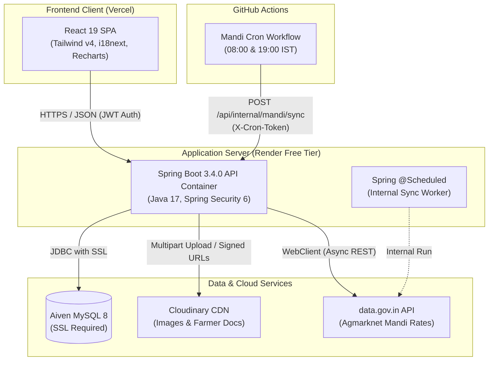
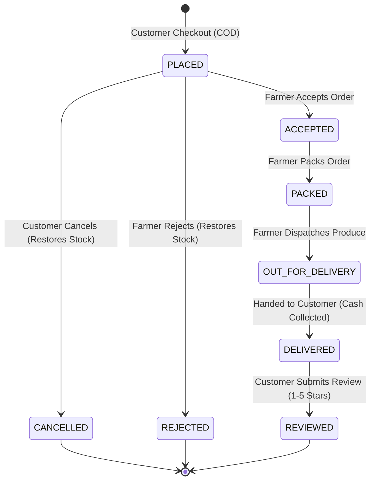
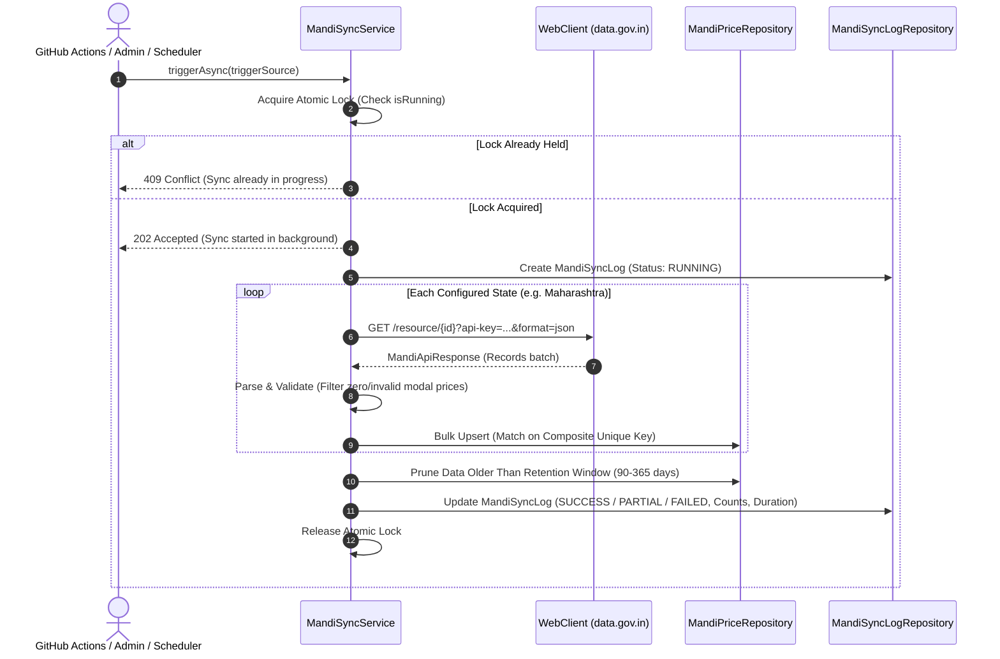

<div align="center">

# 🌾 KisanMandi
### Production-Grade Agri-Commerce & Real-Time APMC Market Intelligence Platform

<p align="center">
  <strong>Bridging Bharat's agricultural divide by connecting rural farmers directly to local consumers while democratizing daily wholesale price transparency.</strong>
</p>

<p align="center">
  KisanMandi is an open-source, full-stack enterprise ecosystem engineered to dismantle multi-tiered intermediary exploitation across India’s agricultural supply chain. Built on a high-throughput <strong>Spring Boot 3 (Java 17)</strong> backend and a modern <strong>React 19 (Tailwind v4)</strong> frontend, the platform pairs an autonomous <strong>farm-to-doorstep marketplace</strong> with a live <strong>APMC wholesale price analytics engine</strong> powered by official Government of India Open Data (Agmarknet).
</p>

<p align="center">
  🚜 <strong>Zero Middlemen</strong> &nbsp;•&nbsp;
  📊 <strong>Live Mandi Rates</strong> &nbsp;•&nbsp;
  📍 <strong>Hyperlocal Geo-Matching</strong> &nbsp;•&nbsp;
  📦 <strong>Atomic Stock & COD</strong> &nbsp;•&nbsp;
  🌐 <strong>English • हिंदी • मराठी</strong>
</p>

<br />

<p align="center">
  <a href="https://www.oracle.com/java/"></a>
  <a href="https://spring.io/projects/spring-boot"></a>
  <a href="https://react.dev/"></a>
  <a href="https://www.mysql.com/"></a>
  <a href="LICENSE"></a>
</p>

<p align="center">
  <a href="LIVE_URL_HERE"><strong>🚀 Explore Live Demo</strong></a> &nbsp;&nbsp;|&nbsp;&nbsp;
  <a href="API_URL_HERE"><strong>📑 Interactive Swagger API</strong></a> &nbsp;&nbsp;|&nbsp;&nbsp;
  <a href="DEMO_VIDEO_URL_HERE"><strong>🎬 Watch Video Walkthrough</strong></a>
</p>

</div>

---

## Table of Contents
1. [The Problem](#the-problem)
2. [The Solution & Key Features](#the-solution--key-features)
3. [What Makes KisanMandi Unique](#what-makes-kisanmandi-unique)
4. [Screenshots](#screenshots)
5. [Tech Stack](#tech-stack)
6. [Architecture & System Flow](#architecture--system-flow)
7. [Entity Relationship (ER) Model](#entity-relationship-er-model)
8. [Project Structure](#project-structure)
9. [API Overview & Role Permissions](#api-overview--role-permissions)
10. [Getting Started Locally](#getting-started-locally)
11. [Environment Variables](#environment-variables)
12. [Running Tests](#running-tests)
13. [Production Deployment & Caveats](#production-deployment--caveats)
14. [Demo Accounts](#demo-accounts)
15. [Data Source & Attribution](#data-source--attribution)
16. [Known Limitations & Future Scope](#known-limitations--future-scope)
17. [Author & License](#author--license)

---

## The Problem

Smallholder farmers in India face systemic hurdles bringing their produce to market:
1. **Middlemen Dependency**: Multiple tiers of village aggregators, commission agents, and wholesalers capture the majority of the consumer rupee, leaving the farmer with thin margins while consumers pay high retail markups.
2. **Produce Freshness & Spoilage**: Fresh vegetables and fruits spend days navigating transit hubs and wholesale yards, diminishing nutritional value and shelf life.
3. **Price Asymmetry**: Farmers often harvest and sell without knowing current wholesale market prices. Middlemen exploit this lack of real-time price transparency by offering below-market rates for bumper harvests.

---

## The Solution & Key Features

KisanMandi bridges this divide through a dual-purpose digital platform: an **open farm-to-table marketplace** paired with a **real-time APMC Mandi market intelligence tracker**.

### Features by User Role

#### Customer
- **Direct Farm Discovery**: Browse fresh produce directly from verified farmers in your region.
- **Hyperlocal Geo Search**: Search farmers and crops by geographical distance using client GPS and the in-database Haversine spherical distance formula.
- **Flexible Catalog Filters**: Filter by produce category, price range, stock availability, and rating.
- **Address Book & Cart**: Manage multiple saved delivery addresses and cart items.
- **Cash on Delivery (COD) Checkout**: Order directly from farmers with transparent Cash on Delivery payment.
- **Real-Time Order Tracking**: Visual step-by-step order lifecycle progress (`PLACED` $\rightarrow$ `ACCEPTED` $\rightarrow$ `PACKED` $\rightarrow$ `OUT_FOR_DELIVERY` $\rightarrow$ `DELIVERED`).
- **Verified Reviews & Ratings**: Submit 1 to 5-star ratings and written feedback once orders are delivered.
- **Multilingual Accessibility**: Toggle between English, simple spoken Hindi, and Marathi with zero page reloads.

#### Farmer
- **Digital Farm Onboarding**: Submit farm details (village, district, pin code, GPS coordinates) and upload identity/land records for admin verification.
- **Crop Catalog Management**: List crops with flexible unit pricing (₹/kg or ₹/quintal), track stock in real time, and upload photos stored securely on Cloudinary.
- **Incoming Order Queue**: Inspect incoming buyer orders, review delivery addresses, and manage dispatch status (`ACCEPT`, `PACK`, `DISPATCH`, `DELIVER`, or `REJECT`).
- **Sales Analytics & Earnings**: Live dashboard monitoring gross revenue, pending orders, completed deliveries, and customer review summaries.
- **APMC Mandi Price Benchmarking**: Compare your farm prices against real-time government wholesale mandi rates before setting prices.
- **Public Farm Profile**: Share a dedicated farm storefront displaying approved crops and buyer feedback.

#### Platform Admin
- **Farmer Verification**: Inspect submitted land/identity documents via time-limited secure Cloudinary links and approve or reject onboarding applications.
- **Catalog & Category Governance**: Create and toggle active status for crop categories.
- **User Moderation**: Temporarily block or unblock users violating community guidelines.
- **Content Moderation**: Hide flagged products or inappropriate customer reviews with mandatory audit reasons.
- **Platform Analytics**: Monitor overall user count, active farmers, order volumes, and GMV.
- **Mandi Sync Operations**: Inspect automated daily synchronization logs and trigger manual APMC sync runs on demand.

---

### Features by Technical Module

- **Stateless Auth & RBAC**: JWT bearer tokens, BCrypt password hashing, role segregation (`CUSTOMER`, `FARMER`, `ADMIN`), and token expiration handling.
- **Security & Throttling**: Sliding-window IP rate limiting (`RateLimitFilter`) protecting authentication and public endpoints from abuse.
- **Cloud Media Pipeline**: Direct file streaming to Cloudinary with secure public ID management and non-public verification document links.
- **Order State Machine & Atomic Inventory**: Strict status transitions (`PLACED` $\rightarrow$ `ACCEPTED` $\rightarrow$ `PACKED` $\rightarrow$ `OUT_FOR_DELIVERY` $\rightarrow$ `DELIVERED`). Stock is atomically reserved at checkout and refunded if cancelled or rejected.
- **Immutable Financial Snapshots**: Past orders freeze the shipping address and line item details (name, unit price, image) so subsequent farmer or address updates never mutate historical receipts.
- **APMC Mandi Price Engine**: Automated data pipeline ingesting daily arrivals from data.gov.in (Agmarknet) with bulk upserts, composite unique deduplication, and trend analytics.
- **Sleep-Resilient Webhook Cron**: External GitHub Actions workflow that awakens sleep-mode backend containers on free cloud tiers to run daily scheduled syncs.

---

## What Makes KisanMandi Unique

1. **Addresses a Real Socio-Economic Need**: Solves genuine supply-chain friction for Indian farmers by bypassing exploitative commission agents.
2. **Government Open Data Integration**: Live integration with the data.gov.in Agmarknet API providing daily wholesale prices from 30+ APMC mandis.
3. **Rigorous Role-Based Access Control**: Strict multi-tenant role authorization where customers, farmers, and administrators have completely segregated views, workflows, and APIs.
4. **Resilient Scheduled Synchronization**: Combines internal Spring `@Scheduled` tasks with an authenticated headless external webhook (`POST /api/internal/mandi/sync`) to overcome free-tier cloud sleep timeouts.
5. **Hyperlocal Mathematical Discovery**: In-database spherical geometry calculation (Haversine formula) enabling users to find the nearest farm gate without expensive proprietary map APIs.
6. **Accessible Multilingual Design**: Thoughtfully translated into spoken conversational Hindi and Marathi using Devanagari typography, retaining natural loanwords farmers use daily (*mandi*, *quintal*, *order*, *login*).

---

## Screenshots

Captured visual walkthroughs of the application are located in [`docs/screenshots/`](docs/screenshots/README.md):

| File | Description | Viewport |
| :--- | :--- | :--- |
| [`01-home.png`](docs/screenshots/README.md) | Marketplace landing page with value proposition and language toggle | Desktop |
| [`02-register-role.png`](docs/screenshots/README.md) | Multi-role registration selector (Farmer vs. Customer) | Desktop |
| [`03-browse-filters.png`](docs/screenshots/README.md) | Product marketplace with category pills and price sliders | Desktop |
| [`04-near-me.png`](docs/screenshots/README.md) | Hyperlocal geo-search with radius slider (Haversine calculation) | Desktop |
| [`05-product-detail.png`](docs/screenshots/README.md) | Crop details, farmer rating badge, and unit pricing | Desktop |
| [`06-cart.png`](docs/screenshots/README.md) | Customer cart with quantity management and delivery calculation | Desktop |
| [`07-checkout.png`](docs/screenshots/README.md) | Delivery address selector and Cash on Delivery confirmation | Desktop |
| [`08-order-tracking.png`](docs/screenshots/README.md) | Visual 5-step order timeline tracking status from Placement to Delivery | Desktop / Mobile |
| [`09-farmer-dashboard.png`](docs/screenshots/README.md) | Farmer portal with live sales metrics, revenue, and active orders | Desktop |
| [`10-add-product.png`](docs/screenshots/README.md) | Crop listing form with Cloudinary image uploader and unit selector | Desktop |
| [`11-incoming-orders.png`](docs/screenshots/README.md) | Incoming order processing queue with dispatch status actions | Desktop |
| [`12-mandi-dashboard.png`](docs/screenshots/README.md) | APMC Mandi tracker with commodity search and Recharts trend graph | Desktop |
| [`13-mandi-mobile.png`](docs/screenshots/README.md) | Mobile responsive Mandi view showing unit toggle (₹/kg vs. ₹/quintal) | Mobile (375px) |
| [`14-reviews.png`](docs/screenshots/README.md) | Verified customer reviews and rolling average ratings | Desktop |
| [`15-admin-dashboard.png`](docs/screenshots/README.md) | Admin platform overview, user counts, and health indicators | Desktop |
| [`16-admin-farmer-approval.png`](docs/screenshots/README.md) | Admin farmer verification queue with document preview | Desktop |
| [`17-swagger.png`](docs/screenshots/README.md) | Springdoc OpenAPI interactive documentation interface | Desktop |
| [`18-hindi-marathi.png`](docs/screenshots/README.md) | Localized interface toggled to Hindi / Marathi | Desktop / Mobile |

---

## Tech Stack

| Domain | Technology | Version | Purpose |
| :--- | :--- | :--- | :--- |
| **Frontend** | React | 19.x | Component-driven user interface |
| | Vite | 6.x | Fast build tooling and hot module replacement |
| | Tailwind CSS | 4.x | Responsive utility styling and typography |
| | Lucide React | Latest | Clean UI iconography |
| | Recharts | 2.x | Historical Mandi price trend and comparison charts |
| | Axios | 1.x | HTTP client with automatic JWT token attachment |
| | i18next | Latest | Multilingual localization (EN, HI, MR) |
| **Backend** | Java | 17 LTS | Core application language |
| | Spring Boot | 3.4.0 | REST API framework, DI container, and scheduling |
| | Spring Security | 6.x | Stateless JWT authentication and RBAC filters |
| | Spring Data JPA | 3.4.0 | ORM database abstraction and repository layer |
| | Spring WebFlux | 3.4.0 | Non-blocking `WebClient` for external API integration |
| | JJWT | 0.12.6 | Cryptographic token creation and validation |
| | Springdoc OpenAPI | 2.7.0 | Swagger UI and OpenAPI 3 schema generation |
| **Database** | MySQL | 8.x | Relational database with composite unique constraints |
| | HikariCP | Default | Optimized database connection pooling |
| **Cloud Services** | Cloudinary | API v2 | Media storage for crop photos and documents |
| | data.gov.in | Agmarknet | Open Government Data API for wholesale rates |
| | Render | Free Tier | Backend Docker container runtime |
| | Vercel | Hobby Tier | Frontend static SPA edge hosting |
| | Aiven | Free Tier | Managed cloud MySQL instance (SSL enforced) |
| | GitHub Actions | Workflows | Continuous Integration and headless daily cron trigger |

---

## Architecture & System Flow

### 1. High-Level System Architecture



### 2. Order Lifecycle State Machine



### 3. APMC Mandi Data Synchronization Flow



---

## Entity Relationship (ER) Model

The database enforces referential integrity, historical snapshots, and composite indexing across 11 primary tables.

Detailed visual schema and design rationale: [**docs/er-diagram.md**](docs/er-diagram.md)

---

## Project Structure

```
KisanMandi/
├── .github/
│   └── workflows/
│       ├── ci.yml                     # Automated Java 17 and Node 20 CI pipeline
│       └── mandi-sync.yml             # Scheduled twice-daily APMC price sync webhook
├── docs/
│   ├── architecture.md               # Technical decisions and layer explanations
│   ├── deployment.md                 # Production deployment guide (Aiven, Render, Vercel)
│   ├── environment-variables.md      # Master environment variables reference
│   ├── api-keys-setup.md             # Guide to obtain Cloudinary and data.gov.in keys
│   ├── er-diagram.md                 # Comprehensive ER diagram and schema design
│   ├── testing.md                    # Test suite breakdown and execution commands
│   ├── screenshots/
│   │   └── README.md                 # Exact checklist of the 18 screenshots to capture
│   └── postman/
│       ├── KisanMandi.postman_collection.json         # Postman v2.1 collection (35+ requests)
│       ├── KisanMandi.local.postman_environment.json  # Postman local environment variables
│       └── README.md                 # Postman & Newman execution guide
├── kisanmandi-backend/
│   ├── Dockerfile                    # Multi-stage production container build (Temurin 17 JRE)
│   ├── pom.xml                       # Maven build descriptor (Spring Boot 3.4.0)
│   └── src/
│       ├── main/java/com/kisanmandi/
│       │   ├── config/               # Security, OpenAPI, Cloudinary, Seeder configs
│       │   ├── controller/           # REST controllers (Auth, Products, Cart, Orders, Admin, Mandi)
│       │   ├── dto/                  # Request records and response transfer objects
│       │   ├── entity/               # JPA domain entities (User, Product, Order, MandiPrice)
│       │   ├── exception/            # Custom exceptions and GlobalExceptionHandler
│       │   ├── repository/           # Spring Data JPA repositories
│       │   ├── security/             # JWT filter, UserDetails, and rate limiter
│       │   └── service/              # Core business rules and external integrations
│       └── test/                     # 80 automated unit and integration tests
├── kisanmandi-frontend/
│   ├── package.json                  # Node dependencies (React 19, Vite, Tailwind v4)
│   ├── vercel.json                   # Vercel SPA routing rewrites and asset caching rules
│   ├── scripts/
│   │   └── check-i18n.mjs            # Deterministic translation key parity checker
│   └── src/
│       ├── api/                      # Axios HTTP client with JWT interceptor
│       ├── components/               # Reusable UI components, modals, and charts
│       ├── context/                  # AuthContext and CartContext global state
│       ├── i18n/                     # i18next configuration and language detector
│       ├── locales/                  # English, Hindi, and Marathi dictionaries (447 keys each)
│       ├── pages/                    # Public, Customer, Farmer, and Admin views
│       └── __tests__/                # 41 Vitest and React Testing Library tests
├── .gitattributes                    # Line ending normalization across OS platforms
├── .gitignore                        # Global ignore rules for secrets and build artifacts
├── LICENSE                           # MIT License
└── README.md                         # Project documentation
```

---

## API Overview & Role Permissions

Interactive OpenAPI documentation is generated live via Springdoc. Once the backend is running, open:
`http://localhost:8080/swagger-ui/index.html`

### Endpoint Groups Overview

| Module | Route Prefix | Access Level | Description |
| :--- | :--- | :--- | :--- |
| **Auth** | `/api/auth` | Public | User registration and JWT login |
| **Health** | `/api/health` | Public | System status and database liveness ping |
| **Products** | `/api/products` | Public | Public catalog search, category filters, and detail |
| **Categories** | `/api/categories` | Public | Active commodity categories list |
| **Mandi** | `/api/mandi` | Public | Daily APMC prices, trends, comparisons, and markets |
| **Nearby** | `/api/nearby` | Public | Haversine distance-based local farm search |
| **Customer** | `/api/customer/addresses` | Customer | Address book management |
| | `/api/customer/cart` | Customer | Shopping cart operations |
| | `/api/customer/orders` | Customer | COD checkout, order tracking, and cancellations |
| | `/api/customer/reviews` | Customer | Rating and review submission for delivered orders |
| **Farmer** | `/api/farmer/profile` | Farmer | Farm profile and verification document upload |
| | `/api/farmer/products` | Farmer | Crop listing, stock updates, and soft delete |
| | `/api/farmer/orders` | Farmer | Incoming order processing and status transitions |
| | `/api/farmer/stats` | Farmer | Farmer gross sales and metrics overview |
| | `/api/farmer/reviews` | Farmer | Customer reviews received by the farmer |
| **Admin** | `/api/admin/stats` | Admin | Platform-wide analytics and indicators |
| | `/api/admin/farmers` | Admin | Farmer approvals, rejections, and document inspection |
| | `/api/admin/categories` | Admin | Create and toggle category availability |
| | `/api/admin/users` | Admin | Account blocking and unblocking |
| | `/api/admin/products` | Admin | Moderation hide and unhide for crop listings |
| | `/api/admin/reviews` | Admin | Moderation hide and unhide for reviews |
| | `/api/admin/mandi` | Admin | Mandi sync execution logs and manual sync trigger |
| **Internal** | `/api/internal/mandi/sync` | `X-Cron-Token` | Headless sync webhook for external schedulers |

---

### Role & Permission Matrix

| Operation | Public | Customer | Farmer | Admin |
| :--- | :---: | :---: | :---: | :---: |
| Browse Marketplace Products | ✅ | ✅ | ✅ | ✅ |
| Search APMC Mandi Rates & Trends | ✅ | ✅ | ✅ | ✅ |
| Register as Customer / Farmer | ✅ | ❌ | ❌ | ❌ |
| Manage Cart & Place Orders (COD) | ❌ | ✅ | ❌ | ❌ |
| Submit Review for Delivered Order | ❌ | ✅ | ❌ | ❌ |
| List Produce & Manage Crop Inventory | ❌ | ❌ | ✅ *(Approved)* | ❌ |
| Process Incoming Orders & Change Status | ❌ | ❌ | ✅ | ❌ |
| Approve / Reject Farmer Applications | ❌ | ❌ | ❌ | ✅ |
| Block Users & Moderate Products/Reviews | ❌ | ❌ | ❌ | ✅ |
| Trigger Manual APMC Mandi Sync | ❌ | ❌ | ❌ | ✅ |

---

## Getting Started Locally

### Prerequisites
- **JDK 17** LTS installed ([Eclipse Temurin](https://adoptium.net/) recommended)
- **Node.js 20+** and `npm` installed
- **MySQL 8.x** running locally on port `3306`
- **Git**

---

### Step 1: Clone and Prepare Database

```powershell
# Clone the repository
git clone https://github.com/kasimshah19/kisanmandi.git
cd kisanmandi

# Log into MySQL and create the local database
mysql -u root -p -e "CREATE DATABASE IF NOT EXISTS kisanmandi_db CHARACTER SET utf8mb4 COLLATE utf8mb4_unicode_ci;"
```

---

### Step 2: Configure Backend Properties

Copy the example configuration file:

```powershell
cd kisanmandi-backend
Copy-Item src/main/resources/application-local.properties.example src/main/resources/application-local.properties
```

Open `src/main/resources/application-local.properties` and configure your credentials:
1. `DB_USERNAME` and `DB_PASSWORD`: Your local MySQL credentials.
2. `JWT_SECRET`: Any random alphanumeric string at least 32 characters long.
3. `APP_ADMIN_EMAIL` and `APP_ADMIN_PASSWORD`: Email and password for the automatically seeded local administrator account.
4. `CLOUDINARY_*` keys: Obtained free from [cloudinary.com](https://cloudinary.com).
5. `MANDI_API_KEY`: Obtained free from [data.gov.in](https://data.gov.in). *(Refer to [docs/api-keys-setup.md](docs/api-keys-setup.md) for step-by-step guidance).*

---

### Step 3: Run the Backend Application

```powershell
# From kisanmandi-backend/
.\mvnw spring-boot:run
```

The Spring Boot backend will start on **`http://localhost:8080`**.
- OpenAPI / Swagger UI: `http://localhost:8080/swagger-ui/index.html`
- Health Endpoint: `http://localhost:8080/api/health`

---

### Step 4: Run the Frontend Application

Open a new PowerShell terminal:

```powershell
cd KisanMandi/kisanmandi-frontend

# Install dependencies
npm install

# Start the Vite development server
npm run dev
```

The React frontend will start on **`http://localhost:5173`**.

---

## Environment Variables

For full variable definitions, production defaults, and platform assignments, refer to:
[**docs/environment-variables.md**](docs/environment-variables.md)

### Key Variables Summary

| Variable | Target Platform | Description |
| :--- | :--- | :--- |
| `SPRING_PROFILES_ACTIVE` | Backend (Render) | Set to `prod` for production deployment |
| `DB_URL` | Backend (Render) | JDBC connection string with SSL enabled |
| `DB_USERNAME` / `DB_PASSWORD` | Backend (Render) | Cloud database credentials |
| `JWT_SECRET` | Backend (Render/Local) | HMAC-SHA secret (minimum 32 characters) |
| `APP_ADMIN_EMAIL` / `APP_ADMIN_PASSWORD` | Backend (Render/Local) | Credentials for bootstrap admin account |
| `CLOUDINARY_CLOUD_NAME` / `API_KEY` / `API_SECRET` | Backend (Render/Local) | Cloudinary media management credentials |
| `MANDI_API_KEY` | Backend (Render/Local) | API key from data.gov.in |
| `APP_CORS_ALLOWED_ORIGINS` | Backend (Render) | Comma-separated allowed frontend origins |
| `MANDI_CRON_TOKEN` | Backend & GitHub Actions | Shared secret token for the sync webhook |
| `VITE_API_BASE_URL` | Frontend (Vercel) | Base API URL pointing to the deployed backend |

---

## Running Tests

Both backend and frontend contain automated test suites running in CI on every push.

### Backend Tests (JUnit 5 + Mockito)
```powershell
cd kisanmandi-backend

# Run all 80 unit and integration tests
.\mvnw test

# Generate JaCoCo coverage report
.\mvnw test jacoco:report
```
*Full testing breakdown: [docs/testing.md](docs/testing.md)*

### Frontend Tests (Vitest + React Testing Library)
```powershell
cd kisanmandi-frontend

# Run all 41 frontend tests
npm test

# Verify 100% translation key parity across EN, HI, MR
npm run i18n:check

# Validate production build
npm run build
```

---

## Production Deployment & Caveats

KisanMandi is configured for seamless deployment on free-tier infrastructure:
- **Frontend**: Vercel Static SPA ([kisanmandi-frontend/vercel.json](kisanmandi-frontend/vercel.json) rewrites).
- **Backend**: Render Web Service ([kisanmandi-backend/Dockerfile](kisanmandi-backend/Dockerfile) multi-stage build).
- **Database**: Aiven MySQL (Free 1 GB service with SSL).
- **APMC Mandi Cron**: GitHub Actions ([.github/workflows/mandi-sync.yml](.github/workflows/mandi-sync.yml)).

Full deployment walkthrough: [**docs/deployment.md**](docs/deployment.md)

### Free-Tier Cloud Caveats
1. **Render Container Sleep**: Free-tier instances spin down after 15 minutes of inactivity. The first request after sleep can experience a **30 to 60 second cold start**. The frontend includes an automated health check ping and an informative banner (`ServerStatusBanner`) that reassures users during cold starts.
2. **Database Inactivity Limits**: Aiven free-tier databases may pause if left untouched for extended periods. Ensure your daily Mandi sync runs to keep the database active.
3. **Mandi Cron Execution**: Because the backend container sleeps, internal Spring schedulers cannot fire while asleep. The included **GitHub Actions workflow** solves this by sending an HTTP POST webhook twice daily, waking Render and executing the sync.

---

## Demo Accounts

The local database automatically provisions the following default test accounts:

| Role | Email | Password | Access Scope |
| :--- | :--- | :--- | :--- |
| **Customer** | `CUSTOMER_DEMO_EMAIL_HERE` | `CUSTOMER_DEMO_PASSWORD_HERE` | Browse, cart, place COD orders, write reviews |
| **Farmer** | `FARMER_DEMO_EMAIL_HERE` | `FARMER_DEMO_PASSWORD_HERE` | Crop inventory, manage incoming orders, view stats |
| **Admin** | *(Private)* | *(Private)* | Approve farmers, moderate catalog, trigger sync |

> [!NOTE]
> The administrator account credentials are configured strictly via environment variables (`APP_ADMIN_EMAIL` and `APP_ADMIN_PASSWORD`) and are never published publicly.

---

## Data Source & Attribution

- **Source**: [data.gov.in](https://data.gov.in) — Open Government Data (OGD) Platform India.
- **Dataset**: *Current Daily Price of Various Commodities from Various Markets (Mandi)* published by the Directorate of Marketing & Inspection (DMI), Ministry of Agriculture and Farmers Welfare (Agmarknet).
- **Pricing Context**: Mandi rates represent **wholesale market prices in ₹ per quintal** (1 quintal = 100 kg). Retail consumer prices typically differ to account for grading, sorting, local cartage, and packaging.
- **Historical Accumulation**: The upstream government API serves only current daily arrivals. Historical price trends accumulate continuously over time through KisanMandi's scheduled daily sync.

---

## Known Limitations & Future Scope

While KisanMandi delivers a complete farm-to-table workflow, several enterprise features are designated for future milestones:
- **Digital Payment Gateways**: Integration with UPI / Razorpay alongside Cash on Delivery.
- **Automated Price Alerts**: Push notifications and SMS alerts when mandi prices for a farmer's crop swing by more than 10%.
- **SMS & WhatsApp Dispatch Alerts**: Twilio / Gupshup integration notifying buyers when orders are packed and dispatched.
- **Dedicated Delivery Partner Role**: Separate mobile portal for local transport drivers to coordinate batch pickups from farm clusters.
- **Mobile Progressive Web App (PWA)**: Offline caching and installable app experience for rural Android users.
- **Expanded Regional Languages**: Adding Gujarati, Kannada, and Telugu localization dictionaries.

---

## Author & License

**Author**: Kasim Shah

### Connect with me:
- **Portfolio**: [kasim-portfolio-umber.vercel.app](https://kasim-portfolio-umber.vercel.app/)
- **LinkedIn**: [Kasim Shah](https://www.linkedin.com/in/kasim-shah-176175340/)
- **GitHub**: [@kasimshah19](https://github.com/kasimshah19)

This project is licensed under the **MIT License** — see the [LICENSE](LICENSE) file for complete details.

---

<p align="center">
  © 2026 <strong>KisanMandi</strong> — Empowering Farmers, Connecting Communities. All rights reserved.
</p>

