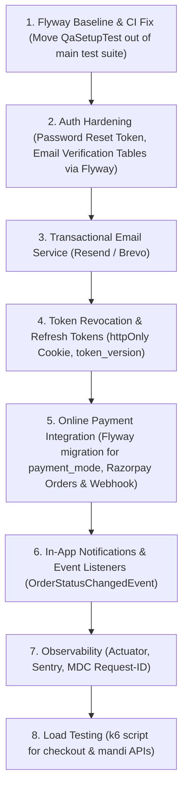

# KisanMandi - Tier 1 Production-Grade Readiness Audit Report
**Audit Date:** October 25, 2026  
**Auditor:** Senior Backend / DevOps Reviewer (Antigravity Agent)  
**Audit Mode:** Read-Only Static & Runtime Code Verification (Local Monorepo)  
**Repository:** `c:\Users\kasim\Downloads\KisanMandi`  
**Git Branch:** `main` (commit `684d407`)  

---

## 1. Baseline Facts (Step 0)

### 1.1 Runtime & Framework Versions
- **Java Version:** OpenJDK `17.0.20.1` 2026-08-18 LTS (Microsoft-14940689)
- **Spring Boot Version:** `3.4.0` (defined in [`kisanmandi-backend/pom.xml:8`](file:///c:/Users/kasim/Downloads/KisanMandi/kisanmandi-backend/pom.xml#L8))
- **Spring Security:** Spring Security `6.4.x` (managed transitively by Spring Boot 3.4.0)
- **Node.js & NPM:** Node.js `v24.19.0`, NPM `11.17.0`
- **React & Frontend Tooling:** React `19.2.8`, Vite `8.3.0`, TailwindCSS `4.3.3`, Vitest `5.0.4`

### 1.2 Direct Dependencies
#### Backend ([`pom.xml`](file:///c:/Users/kasim/Downloads/KisanMandi/kisanmandi-backend/pom.xml))
1. `org.springframework.boot:spring-boot-starter-data-jpa`
2. `org.springframework.boot:spring-boot-starter-security`
3. `org.springframework.boot:spring-boot-starter-validation`
4. `org.springframework.boot:spring-boot-starter-web`
5. `org.springframework.boot:spring-boot-starter-webflux`
6. `com.mysql:mysql-connector-j` (scope: runtime)
7. `org.projectlombok:lombok` (optional: true)
8. `io.jsonwebtoken:jjwt-api:0.12.6`
9. `io.jsonwebtoken:jjwt-impl:0.12.6` (scope: runtime)
10. `io.jsonwebtoken:jjwt-jackson:0.12.6` (scope: runtime)
11. `com.cloudinary:cloudinary-http44:1.39.0`
12. `org.springdoc:springdoc-openapi-starter-webmvc-ui:2.7.0`
13. `org.springframework.boot:spring-boot-devtools` (scope: runtime, optional)
14. `org.springframework.boot:spring-boot-starter-test` (scope: test)
15. `org.springframework.security:spring-security-test` (scope: test)
16. `com.h2database:h2` (scope: test)
*Plugins:* `spring-boot-maven-plugin:3.4.0`, `jacoco-maven-plugin:0.8.12`

#### Frontend ([`package.json`](file:///c:/Users/kasim/Downloads/KisanMandi/kisanmandi-frontend/package.json))
- **Dependencies (12):** `@tailwindcss/vite:^4.3.3`, `axios:^1.20.0`, `i18next:^26.4.4`, `i18next-browser-languagedetector:^8.2.1`, `lucide-react:^1.52.0`, `react:^19.2.8`, `react-dom:^19.2.8`, `react-hot-toast:^2.6.1`, `react-i18next:^17.0.16`, `react-router-dom:^7.18.4`, `recharts:^3.10.1`, `tailwindcss:^4.3.3`
- **DevDependencies (8):** `@testing-library/react:^16.3.3`, `@types/react:^19.2.18`, `@types/react-dom:^19.2.7`, `@vitejs/plugin-react:^6.1.1`, `jsdom:^30.1.2`, `oxlint:^1.81.0`, `vite:^8.3.0`, `vitest:^5.0.4`

### 1.3 Spring Profiles & DDL-Auto Configurations
| Property File | Path | `spring.jpa.hibernate.ddl-auto` Setting | Line Number |
| :--- | :--- | :--- | :--- |
| `application.properties` | `src/main/resources/application.properties` | `update` | Line 14 |
| `application-local.properties` | `src/main/resources/application-local.properties` | *(Not set; inherits `update`)* | N/A |
| `application-prod.properties` | `src/main/resources/application-prod.properties` | `${DDL_AUTO:update}` | Line 9 |
| `application-test.properties` | `src/test/resources/application-test.properties` | `create-drop` | Line 6 |

### 1.4 Workflows, Folders & Git
- **Files under `.github/workflows`:** `ci.yml`, `mandi-sync.yml`
- **Top-level folders:** `.git`, `.github`, `.vscode`, `docs`, `kisanmandi-backend`, `kisanmandi-frontend`, `qa-temp`
- **Active Git Branch:** `main`
- **Last 10 Commit Subjects:**
  - `684d407` feat(ui): UI v2 Parts 3 & 4 - Customer, Farmer Area, Mandi Simple View, Admin Polish & Global Checks
  - `6221af3` fix(mobile): show green brand header on top with white form card below in Login and Register
  - `41977bd` feat(ui): UI v2 redesign - Foundation, Home, About, Help, Navbar, Footer & Recruiter Hub
  - `f981cfc` feat: Complete KisanMandi frontend redesign (Design tokens, Marketplace, Farmer Studio, Admin Portal & Mandi)
  - `163fcd3` fix(lint): resolve IDE null constraint warnings and clean unused imports
  - `46e9485` feat(qa): complete Round 2 QA audit, full bug fixes, regression tests, and docs
  - `5c0c3aa` fix(backend): consolidate CORS configuration into SecurityConfig to eliminate bean conflict
  - `7b72f5d` docs: rename testing.md to test-cases.md and update references
  - `a176a5f` docs: expand testing.md with exhaustive enterprise-grade test specifications and tables
  - `91d0ef2` docs: add comprehensive test case specifications and tables in testing.md and README

### 1.5 Database Tables (`SHOW TABLES;` from local MySQL `kisanmandi_db`)
Total 12 tables:
1. `addresses`
2. `cart_items`
3. `categories`
4. `farmer_profiles`
5. `mandi_prices`
6. `mandi_sync_logs`
7. `order_items`
8. `order_status_history`
9. `orders`
10. `products`
11. `reviews`
12. `users`

### 1.6 JPA Entities in Codebase
Total 12 entities located under [`kisanmandi-backend/src/main/java/com/kisanmandi/entity`](file:///c:/Users/kasim/Downloads/KisanMandi/kisanmandi-backend/src/main/java/com/kisanmandi/entity):
- `Address`, `CartItem`, `Category`, `FarmerProfile`, `MandiPrice`, `MandiSyncLog`, `Order`, `OrderItem`, `OrderStatusHistory`, `Product`, `Review`, `User`
- Supporting Enums: `ApprovalStatus`, `OrderStatus`, `PaymentMode`, `PaymentStatus`, `PriceSource`, `ProductUnit`, `Role`, `SyncStatus`, `SyncTrigger`, `UserStatus`

### 1.7 Verified Test Counts
- **Backend (`mvn test`):**
  - **Result:** `Tests run: 92, Failures: 0, Errors: 0, Skipped: 0` (Build Time: 01:06 min)
  - **JaCoCo Coverage:** 42% instructions (4,569 / 10,825), 35% branches (306 / 867), 44.4% lines (1,083 / 2,438) across 91 classes.
  - *Critical Discovery:* 90 tests run on in-memory H2, but `com.kisanmandi.qa.QaSetupTest` is hardcoded with `@ActiveProfiles("local")` and executed data mutations against the live local MySQL server.
- **Frontend (`npm test`):**
  - **Result:** `Test Files: 10 passed (10), Tests: 126 passed (126)` (Duration: 76.44s)

---

## 2. Summary Audit Matrix

| # | Feature / Sub-Item | Status | One-Line Reason | Effort | External Account / Key Needed? |
| :--- | :--- | :--- | :--- | :--- | :--- |
| **1** | **Flyway / DB Migrations** | **MISSING** | No flyway dependencies, no migration directory, all 12 tables created via Hibernate auto-DDL. | M | No |
| **2a** | **Email Verification** | **MISSING** | No `email_verified` column, no token entity, no mail sender starter, no endpoints, no UI. | M | Yes (Resend / Brevo / SMTP: `MAIL_USERNAME`, `MAIL_PASSWORD`) |
| **2b** | **Forgot / Reset Password** | **MISSING** | No reset token table, no endpoints in `AuthController`, no frontend pages or routes. | M | Yes (Shared with 2a for email reset link delivery) |
| **2c** | **Change Password (Logged-in)** | **MISSING** | No endpoint in `AuthController` or `UserService`, no UI modal or profile settings tab. | S | No |
| **2d** | **Refresh Tokens** | **MISSING** | No refresh token table/rotation; single 24h JWT stored directly in `localStorage`. | M | No |
| **2e** | **Logout & Token Revocation** | **PARTIAL** | Frontend wipes `localStorage`, but backend has no server-side logout, no blacklist, and no `token_version`. JWT stays valid for 24 hours. | S | No |
| **2f** | **Login Lockout / Brute-force** | **PARTIAL** | In-memory `RateLimitFilter` tracks client IP (10/min login), but has no user lockout counter and is vulnerable to `X-Forwarded-For` spoofing. | S | No |
| **2g** | **Auth Hardening: Other** | **PARTIAL** | Passwords allow weak 6-char strings; JWT in `localStorage` vulnerable to XSS; no auth event audit logging; no account deletion. | M | No |
| **3** | **Online Payment (Gateway)** | **MISSING** | No payment SDK/gateway client, no webhook/verify endpoints, `PaymentMode` enum contains only `COD`. | L | Yes (Razorpay: `RAZORPAY_KEY_ID`, `RAZORPAY_KEY_SECRET`, `RAZORPAY_WEBHOOK_SECRET`) |
| **4a** | **In-App Notifications** | **MISSING** | No notifications table, no endpoints, no UI bell icon or dropdown in Navbar. | M | No |
| **4b** | **Real-Time Transport** | **STUB/FAKE** | No WebSocket, no SSE. Replaced entirely by 30s client-side polling in `OrderTracking.jsx` and 5s in `MandiSyncLogs.jsx`. | M | No |
| **4c** | **Event Publishing & Email** | **MISSING** | No `ApplicationEventPublisher` or `@TransactionalEventListener` for order milestones; zero email dispatching. | M | Yes (Shared transactional mail key) |
| **5** | **Observability** | **PARTIAL** | Custom `GET /api/health` exists, but no Actuator, no Prometheus metrics, no correlation-ID/MDC filter, no Sentry SDK. | M | Yes (Sentry DSN: `SENTRY_DSN`, `VITE_SENTRY_DSN`) |
| **6** | **Testing and CI/CD** | **PARTIAL** | Solid unit/integration test count (92 backend, 126 frontend), but no Testcontainers, no E2E/Playwright, and CI runs `QaSetupTest` which mutates local MySQL. | M | No |
| **7** | **Load & Concurrency Testing**| **PARTIAL** | Robust atomic SQL stock decrement (`decreaseStock`), but no k6/JMeter scripts; concurrency evidence is limited to a 2-thread Python script in `qa-temp/`. | S | No |

---

## 3. Detail Section per Feature

### Feature 1: Flyway / DB Migrations
- **Status:** **MISSING**
- **What Exists:**
  - Database schema exists directly in MySQL with 12 operational tables ([`SHOW CREATE TABLE`](file:///c:/Users/kasim/Downloads/KisanMandi/kisanmandi-backend/src/main/resources/application.properties#L14)).
  - Startup data seeding is handled imperatively via Spring `CommandLineRunner` beans:
    - [`CategorySeeder.java:17`](file:///c:/Users/kasim/Downloads/KisanMandi/kisanmandi-backend/src/main/java/com/kisanmandi/config/CategorySeeder.java#L17) checks `categoryRepository.count() == 0` and inserts 7 categories.
    - [`DataSeeder.java:14`](file:///c:/Users/kasim/Downloads/KisanMandi/kisanmandi-backend/src/main/java/com/kisanmandi/config/DataSeeder.java#L14) checks `!userRepository.existsByRole(Role.ADMIN)` and creates the default admin user.
    - [`DemoAccountsSeeder.java:23`](file:///c:/Users/kasim/Downloads/KisanMandi/kisanmandi-backend/src/main/java/com/kisanmandi/config/DemoAccountsSeeder.java#L23) seeds demo farmer and customer accounts.
- **What is Missing:**
  - `flyway-core` and `flyway-mysql` are missing from [`pom.xml`](file:///c:/Users/kasim/Downloads/KisanMandi/kisanmandi-backend/pom.xml).
  - Directory `src/main/resources/db/migration` does not exist (`Test-Path src/main/resources/db` returned `False`).
  - No `spring.flyway.*` properties in any `.properties` file.
  - Table `flyway_schema_history` does not exist in `kisanmandi_db`.
- **Drift / Risks:**
  - In [`application-prod.properties:9`](file:///c:/Users/kasim/Downloads/KisanMandi/kisanmandi-backend/src/main/resources/application-prod.properties#L9), `spring.jpa.hibernate.ddl-auto=${DDL_AUTO:update}`. Running `update` in production on Aiven/Render can lead to table locks, corrupted schemas, inability to rename columns, and untracked changes across deployments.
  - Foreign key and index names generated by Hibernate are random hashes (e.g., `FK44re9virojxhvpsn2jn63bab0`, `UK6dotkott2kjsp8vw4d0m25fb7`), making manual DDL maintenance hazardous.
- **Safe Baseline Migration Specification:**
  A migration baseline must introduce `V1__init_schema.sql` declaring standard DDL for the 12 tables with canonical constraint names, followed by setting `spring.flyway.baseline-on-migrate=true` and switching `spring.jpa.hibernate.ddl-auto=validate`.

---

### Feature 2: Auth Hardening

#### 2a: Email Verification
- **Status:** **MISSING**
- **Evidence:**
  - Database table `users` contains: `id`, `name`, `email`, `password`, `phone`, `role`, `status`, `blocked_reason`, `created_at` ([`User.java:11-58`](file:///c:/Users/kasim/Downloads/KisanMandi/kisanmandi-backend/src/main/java/com/kisanmandi/entity/User.java#L11-L58)). No `email_verified` or `verification_token` column.
  - No `spring-boot-starter-mail` or `JavaMailSender` exists in `pom.xml`.
  - [`AuthController.java`](file:///c:/Users/kasim/Downloads/KisanMandi/kisanmandi-backend/src/main/java/com/kisanmandi/controller/AuthController.java) has only 3 endpoints: `/register`, `/login`, `/me`.
  - Frontend has no `/verify-email` route in [`App.jsx`](file:///c:/Users/kasim/Downloads/KisanMandi/kisanmandi-frontend/src/App.jsx).

#### 2b: Forgot & Reset Password
- **Status:** **MISSING**
- **Evidence:**
  - No password reset token entity or table in DB.
  - Zero endpoints matching `forgot-password` or `reset-password` in [`AuthController.java`](file:///c:/Users/kasim/Downloads/KisanMandi/kisanmandi-backend/src/main/java/com/kisanmandi/controller/AuthController.java).
  - Frontend `Login.jsx` has no "Forgot Password?" link or recovery screen.

#### 2c: Change Password for Logged-In Users
- **Status:** **MISSING**
- **Evidence:**
  - Grep for `changePassword`, `updatePassword`, or `resetPassword` across `src/main/java` yielded 0 results.
  - Farmer profile page ([`FarmerProfile.jsx`](file:///c:/Users/kasim/Downloads/KisanMandi/kisanmandi-frontend/src/pages/farmer/FarmerProfile.jsx)) has fields for farm details only, with no password change form.

#### 2d: Refresh Tokens
- **Status:** **MISSING**
- **Evidence:**
  - Token expiration in [`application.properties:26`](file:///c:/Users/kasim/Downloads/KisanMandi/kisanmandi-backend/src/main/resources/application.properties#L26) is set to `86400000` ms (24 hours).
  - Frontend [`AuthContext.jsx:51`](file:///c:/Users/kasim/Downloads/KisanMandi/kisanmandi-frontend/src/context/AuthContext.jsx#L51) stores the 24-hour token in `localStorage.setItem('kisanmandi_token', data.token)`.
  - [`axiosInstance.js:18`](file:///c:/Users/kasim/Downloads/KisanMandi/kisanmandi-frontend/src/services/axiosInstance.js#L18) reads `localStorage.getItem(TOKEN_KEY)` and attaches it as `Bearer`.
  - No refresh endpoint, no token rotation, no refresh interceptor.

#### 2e: Logout and Token Revocation
- **Status:** **PARTIAL**
- **Evidence:**
  - Frontend logout in [`AuthContext.jsx:66-68`](file:///c:/Users/kasim/Downloads/KisanMandi/kisanmandi-frontend/src/context/AuthContext.jsx#L66-L68) simply removes `kisanmandi_token` and `kisanmandi_user` from `localStorage`.
  - Backend has no `/api/auth/logout` endpoint.
  - In [`JwtAuthFilter.java:51-67`](file:///c:/Users/kasim/Downloads/KisanMandi/kisanmandi-backend/src/main/java/com/kisanmandi/security/JwtAuthFilter.java#L51-L67), every request validates JWT signature/expiry and re-checks the DB via `userDetailsService.loadUserByUsername(email)`:
    - If admin blocks the user (`status = BLOCKED`), `userDetails.isEnabled()` returns `false`, which immediately rejects requests.
    - **Gap:** If a user logs out on the frontend or changes passwords, the JWT remains completely valid until its 24-hour expiration because there is no blacklist table, Redis cache, or `token_version` on the user entity.

#### 2f: Login Lockout / Brute-Force
- **Status:** **PARTIAL**
- **Evidence:**
  - [`RateLimitFilter.java:23-56`](file:///c:/Users/kasim/Downloads/KisanMandi/kisanmandi-backend/src/main/java/com/kisanmandi/security/RateLimitFilter.java#L23-L56) implements an in-memory sliding window using `ConcurrentHashMap<String, Deque<Long>>`:
    - `POST /api/auth/login`: max 10 requests per minute.
    - `POST /api/auth/register`: max 5 requests per minute.
    - Cleans up stale entries via `@Scheduled(fixedRate = 60000)`.
  - **Gaps & Vulnerabilities:**
    - Storage is strictly in-memory: restarts or Render free tier idling wipe all counters.
    - No user-level lockout: There is no `failed_attempts` or `locked_until` field on `User`. A distributed brute-force attack rotating IPs can guess passwords indefinitely without triggering account lockout.
    - [`RateLimitFilter.java:103`](file:///c:/Users/kasim/Downloads/KisanMandi/kisanmandi-backend/src/main/java/com/kisanmandi/security/RateLimitFilter.java#L103) blindly trusts the first comma-separated value of `X-Forwarded-For` without proxy CIDR verification, allowing trivial IP spoofing by clients.

#### 2g: Other Auth Hardening Factors
- **Password Policy:**
  - Backend: [`RegisterRequest.java:26`](file:///c:/Users/kasim/Downloads/KisanMandi/kisanmandi-backend/src/main/java/com/kisanmandi/dto/RegisterRequest.java#L26) enforces only `@Size(min = 6, max = 100)`.
  - Frontend: [`Register.jsx:87`](file:///c:/Users/kasim/Downloads/KisanMandi/kisanmandi-frontend/src/pages/public/Register.jsx#L87) validates only `form.password.length >= 6`. Passwords like `123456` or `aaaaaa` are accepted.
- **Storage & XSS/CSRF:**
  - JWT is stored directly in `localStorage` ([`AuthContext.jsx:51`](file:///c:/Users/kasim/Downloads/KisanMandi/kisanmandi-frontend/src/context/AuthContext.jsx#L51)). Any XSS flaw on the domain can steal the 24-hour token. (CSRF is not an issue since cookie auth is not used).
- **Audit Logging:**
  - [`AuthService.java`](file:///c:/Users/kasim/Downloads/KisanMandi/kisanmandi-backend/src/main/java/com/kisanmandi/service/AuthService.java) has no logger initialized: auth successes, failures, and blocked logins produce 0 log lines.
- **Account Deletion:**
  - Neither users nor admins can delete an account. Admin only has `POST /api/admin/users/{userId}/block` ([`AdminController.java:61`](file:///c:/Users/kasim/Downloads/KisanMandi/kisanmandi-backend/src/main/java/com/kisanmandi/controller/AdminController.java#L61)).

---

### Feature 3: Online Payment (Razorpay / Gateway)
- **Status:** **MISSING**
- **What Exists:**
  - [`PaymentMode.java:3`](file:///c:/Users/kasim/Downloads/KisanMandi/kisanmandi-backend/src/main/java/com/kisanmandi/entity/PaymentMode.java#L3): Contains only `COD`.
  - [`PaymentStatus.java:3`](file:///c:/Users/kasim/Downloads/KisanMandi/kisanmandi-backend/src/main/java/com/kisanmandi/entity/PaymentStatus.java#L3): Contains `PENDING`, `PAID`.
  - [`OrderService.java:74`](file:///c:/Users/kasim/Downloads/KisanMandi/kisanmandi-backend/src/main/java/com/kisanmandi/service/OrderService.java#L74): Checkout assigns `request.getPaymentMode()` (always COD).
  - Cash collection mark: [`FarmerOrderService.java:122-124`](file:///c:/Users/kasim/Downloads/KisanMandi/kisanmandi-backend/src/main/java/com/kisanmandi/service/FarmerOrderService.java#L122-L124) automatically sets `order.setPaymentStatus(PaymentStatus.PAID)` when farmer transitions status to `DELIVERED` for COD orders.
  - Server-side amount computation: [`OrderService.java:96`](file:///c:/Users/kasim/Downloads/KisanMandi/kisanmandi-backend/src/main/java/com/kisanmandi/service/OrderService.java#L96) computes line totals with `p.getPricePerUnit().multiply(cItem.getQuantity()).setScale(2, RoundingMode.HALF_UP)` preventing client price tampering.
- **What is Missing:**
  - No Razorpay / Cashfree / Stripe SDK in `pom.xml`.
  - No `Payment` entity or payment transaction table.
  - No payment endpoints: `/create-order`, `/verify`, `/webhook`, `/refund`.
  - No HMAC-SHA256 signature verification logic.
  - Frontend [`Checkout.jsx:103`](file:///c:/Users/kasim/Downloads/KisanMandi/kisanmandi-frontend/src/pages/customer/Checkout.jsx#L103) hardcodes `orderService.checkout(selectedAddressId, 'COD')`.
  - No refund flag or refund status when an order is cancelled or rejected.
- **Reusable Foundation for Payment:**
  - `Order` entity already maintains `paymentMode` and `paymentStatus` fields.
  - `OrderStatusHistory` already records immutable audit trails.
  - Atomic stock decrements and restorative increments exist on cancel/reject.

---

### Feature 4: Notifications & Real-Time Updates

#### 4a: In-App Notifications
- **Status:** **MISSING**
- **Evidence:**
  - No `Notification` entity, repository, or controller in backend.
  - Frontend [`Navbar.jsx`](file:///c:/Users/kasim/Downloads/KisanMandi/kisanmandi-frontend/src/components/Navbar.jsx) has no notification bell icon, badge, or notification dropdown.

#### 4b: Real-Time Transport
- **Status:** **STUB/FAKE**
- **Evidence:**
  - Zero usage of `SseEmitter`, `WebSocket`, or STOMP in backend.
  - Real-time order updates are simulated via client-side polling:
    - [`OrderTracking.jsx:56-64`](file:///c:/Users/kasim/Downloads/KisanMandi/kisanmandi-frontend/src/pages/customer/OrderTracking.jsx#L56-L64): Polls `orderService.get(id)` every 30 seconds (`setInterval(..., 30000)`).
    - [`MandiSyncLogs.jsx:39-46`](file:///c:/Users/kasim/Downloads/KisanMandi/kisanmandi-frontend/src/pages/admin/MandiSyncLogs.jsx#L39-L46): Polls `adminMandiService.getStatus()` every 5 seconds while `isSyncing` is active.
  - *Hosting constraint:* On Render's free tier, open SSE/WebSocket connections are terminated when the instance sleeps after 15 minutes of inactivity. Polling with page visibility pausing is practically more resilient on free hosting.

#### 4c: Internal Event Publishing & Transactional Emails
- **Status:** **MISSING**
- **Evidence:**
  - No `ApplicationEventPublisher`, `@EventListener`, or `@TransactionalEventListener` across the backend.
  - Order status changes in [`FarmerOrderService.java:64-136`](file:///c:/Users/kasim/Downloads/KisanMandi/kisanmandi-backend/src/main/java/com/kisanmandi/service/FarmerOrderService.java#L64-L136) and [`OrderService.java:41-127`](file:///c:/Users/kasim/Downloads/KisanMandi/kisanmandi-backend/src/main/java/com/kisanmandi/service/OrderService.java#L41-L127) directly execute DB updates with no events emitted.
  - No email sending or email templates for order milestones (`PLACED`, `ACCEPTED`, `DELIVERED`).

---

### Feature 5: Observability
- **Status:** **PARTIAL**
- **What Exists:**
  - Custom health endpoint at [`HealthController.java:29-47`](file:///c:/Users/kasim/Downloads/KisanMandi/kisanmandi-backend/src/main/java/com/kisanmandi/controller/HealthController.java#L29-L47):
    - Exposes `GET /api/health` returning JSON with app name, active profile, and tests database connectivity via `jdbcTemplate.queryForObject("SELECT 1", Integer.class)`.
  - Clean global exception handling via [`GlobalExceptionHandler.java:24-178`](file:///c:/Users/kasim/Downloads/KisanMandi/kisanmandi-backend/src/main/java/com/kisanmandi/exception/GlobalExceptionHandler.java#L24-L178):
    - Handlers for validation errors, auth exceptions, duplicate emails, stock exhaustion, and catch-all 500s.
  - API Key Masking: [`MandiApiClient.java:68-74`](file:///c:/Users/kasim/Downloads/KisanMandi/kisanmandi-backend/src/main/java/com/kisanmandi/service/MandiApiClient.java#L68-L74) sanitizes error messages by masking the mandi API key with `***`.
- **What is Missing:**
  - `spring-boot-starter-actuator` is missing from `pom.xml`. No `/actuator/health`, `/actuator/metrics`, or `/actuator/prometheus`.
  - No correlation/request-id filter, no MDC (`Mapped Diagnostic Context`), and no `X-Request-Id` header returned in HTTP responses.
  - No custom metrics (no Micrometer `Counter`, `Timer`, or `@Timed`).
  - No structured JSON logging (`logback-spring.xml` does not exist; default standard text logging is used).
  - Sentry is absent in both backend (`sentry-spring-boot-starter` missing) and frontend (`@sentry/react` missing).
  - No slow-query logging configured in Hibernate properties.

---

### Feature 6: Testing and CI/CD
- **Status:** **PARTIAL**
- **What Exists:**
  - **Backend Test Suite:** 92 passing tests in `kisanmandi-backend` across 22 test files ([`surefire test run log`](file:///c:/Users/kasim/Downloads/KisanMandi/kisanmandi-backend/target/site/jacoco/index.html)).
  - **Frontend Test Suite:** 126 passing Vitest unit/component tests across 10 files ([`vitest test run log`](file:///c:/Users/kasim/Downloads/KisanMandi/kisanmandi-frontend/src/__tests__)).
  - **JaCoCo Coverage Plugin:** Configured in [`pom.xml:143-162`](file:///c:/Users/kasim/Downloads/KisanMandi/kisanmandi-backend/pom.xml#L143-L162), generating coverage reports on `mvn test`.
  - **Docker Setup:** Production multi-stage [`Dockerfile`](file:///c:/Users/kasim/Downloads/KisanMandi/kisanmandi-backend/Dockerfile) with memory tuning for 512 MB containers (`MaxRAMPercentage=65`, `UseSerialGC`, `TieredStopAtLevel=1`), running as non-root `appuser`.
  - **CI Workflows:**
    - [`.github/workflows/ci.yml`](file:///c:/Users/kasim/Downloads/KisanMandi/.github/workflows/ci.yml): Triggers on `push` and `pull_request` to `main`. Builds backend (`mvn -B test`) and frontend (`npm ci`, `npm run i18n:check`, `npm run build`, `npm test`).
    - [`.github/workflows/mandi-sync.yml`](file:///c:/Users/kasim/Downloads/KisanMandi/.github/workflows/mandi-sync.yml): Triggers on scheduled cron (08:00 & 19:00 IST) and `workflow_dispatch` to invoke backend mandi sync endpoint using secret `MANDI_CRON_TOKEN`.
- **What is Missing & Critical Drift:**
  - **Critical Test Pollution:** [`QaSetupTest.java:14`](file:///c:/Users/kasim/Downloads/KisanMandi/kisanmandi-backend/src/test/java/com/kisanmandi/qa/QaSetupTest.java#L14) is hardcoded with `@ActiveProfiles("local")`. It connects to `jdbc:mysql://127.0.0.1:3306/kisanmandi_db` during normal test execution. On GitHub Actions runners where MySQL is not running on port 3306, `mvn -B test` will fail!
  - No Testcontainers dependency in `pom.xml`.
  - No Playwright, Cypress, or E2E integration test suite.
  - No auto-deployment jobs to Render or Vercel.
  - README badges are static shields.io badges; no dynamic CI build badge.

---

### Feature 7: Load & Concurrency Testing
- **Status:** **PARTIAL**
- **What Exists:**
  - **Atomic Stock Protection:** [`ProductRepository.java:53-55`](file:///c:/Users/kasim/Downloads/KisanMandi/kisanmandi-backend/src/main/java/com/kisanmandi/repository/ProductRepository.java#L53-L55) uses a single atomic SQL statement:
    ```sql
    UPDATE Product p SET p.quantityAvailable = p.quantityAvailable - :qty 
    WHERE p.id = :id AND p.quantityAvailable >= :qty AND p.active = true AND p.deleted = false
    ```
    If `updatedRows == 0`, [`OrderService.java:93`](file:///c:/Users/kasim/Downloads/KisanMandi/kisanmandi-backend/src/main/java/com/kisanmandi/service/OrderService.java#L93) throws `InsufficientStockException`. This relies on MySQL row locks and completely prevents overselling.
  - **Atomic State Transitions:** [`OrderRepository.java`](file:///c:/Users/kasim/Downloads/KisanMandi/kisanmandi-backend/src/main/java/com/kisanmandi/repository/OrderRepository.java) uses `updateStatusIfCurrentStatus(orderId, current, target)` ensuring that concurrent status updates (e.g. customer cancel vs farmer accept) fail gracefully.
  - **Race Condition Verification Script:** [`qa-temp/run_concurrency_and_all.py:204-280`](file:///c:/Users/kasim/Downloads/KisanMandi/qa-temp/run_concurrency_and_all.py#L204-L280) uses Python's `ThreadPoolExecutor(max_workers=2)` to verify race conditions on Product 9 (last unit stock), Order 10 (parallel reviews), and Order 11 (cancel vs accept).
- **What is Missing:**
  - No load testing tools: No k6, JMeter, Gatling, or Artillery scripts or folders exist in the repository.
  - Concurrency evidence in [`docs/QA-REPORT.md:227-241`](file:///c:/Users/kasim/Downloads/KisanMandi/docs/QA-REPORT.md#L227-L241) reflects 2 concurrent requests, not sustained high-load/throughput testing (no RPS, latency percentiles, or ramp-up profiles).
  - No checkout idempotency key: Checkout endpoint [`CustomerOrderController.java:38-42`](file:///c:/Users/kasim/Downloads/KisanMandi/kisanmandi-backend/src/main/java/com/kisanmandi/controller/CustomerOrderController.java#L38-L42) lacks an `Idempotency-Key` header. Double clicks on slow connections before cart deletion finishes could result in duplicate orders if stock permits.

---

## 4. Drift & Bug Findings Discovered During Audit

| # | Severity | Component | Finding & Real Evidence |
| :--- | :--- | :--- | :--- |
| **BUG-01** | **CRITICAL** | Backend Tests / DB Isolation | [`QaSetupTest.java:14`](file:///c:/Users/kasim/Downloads/KisanMandi/kisanmandi-backend/src/test/java/com/kisanmandi/qa/QaSetupTest.java#L14) has `@ActiveProfiles("local")` hardcoded. Running `mvn test` mutates the live local MySQL database (`users`, `farmer_profiles`). In standard CI environments without MySQL, this will cause the build to fail. |
| **BUG-02** | **HIGH** | Security / Rate Limiting | In [`RateLimitFilter.java:103`](file:///c:/Users/kasim/Downloads/KisanMandi/kisanmandi-backend/src/main/java/com/kisanmandi/security/RateLimitFilter.java#L103), the filter trusts `xForwardedFor.split(",")[0].trim()` without validating trusted proxy hops. Any client can bypass the 10 req/min login limit by sending arbitrary IP addresses in `X-Forwarded-For`. |
| **BUG-03** | **HIGH** | Production DB Configuration | In [`application-prod.properties:9`](file:///c:/Users/kasim/Downloads/KisanMandi/kisanmandi-backend/src/main/resources/application-prod.properties#L9), `spring.jpa.hibernate.ddl-auto=${DDL_AUTO:update}`. Hibernate auto-DDL runs by default in production. There are no Flyway migrations. |
| **BUG-04** | **HIGH** | Security / Session Invalidation | Access tokens are valid for 24 hours ([`application.properties:26`](file:///c:/Users/kasim/Downloads/KisanMandi/kisanmandi-backend/src/main/resources/application.properties#L26)). There is no server-side logout, blacklist, or `token_version`. Logging out on the frontend does not invalidate the token on the server. |
| **BUG-05** | **MEDIUM** | DB Enum Restriction | Table `orders` has column ``payment_mode` enum('COD') NOT NULL` ([MySQL `SHOW CREATE TABLE orders`](file:///c:/Users/kasim/Downloads/KisanMandi/kisanmandi-backend/src/main/resources/application.properties#L8)). Adding online payment will fail at the database level unless a migration updates this enum. |
| **BUG-06** | **MEDIUM** | Password Security | Backend [`RegisterRequest.java:26`](file:///c:/Users/kasim/Downloads/KisanMandi/kisanmandi-backend/src/main/java/com/kisanmandi/dto/RegisterRequest.java#L26) and frontend [`Register.jsx:87`](file:///c:/Users/kasim/Downloads/KisanMandi/kisanmandi-frontend/src/pages/public/Register.jsx#L87) enforce only `length >= 6`. No complexity requirements are enforced. |
| **BUG-07** | **LOW** | External API Call in Tests | During `mvn test`, `InternalCronIntegrationTest` triggers `MandiSyncService`, which makes real outbound calls to `api.data.gov.in` returning `403 FORBIDDEN` in test logs ([task-103 log line 120](file:///C:/Users/kasim/.gemini/antigravity-ide/brain/be0cf347-8529-48d4-b8e0-6858f8ee29ea/.system_generated/tasks/task-103.log#L120)). External APIs should be mocked. |

---

## 5. Suggested Build Order & 2-Week Value Plan

### Recommended Dependency-Aware Build Order


### 2-Week High-Impact Sprint (If only 2 weeks available)
- **Week 1: Stability, Schema Baseline & Essential Security**
  1. Fix `QaSetupTest.java` (annotate with `@Disabled` or move to separate profile so CI tests run cleanly on H2).
  2. Implement Flyway: Add `flyway-core`, `flyway-mysql`, create `V1__init_schema.sql`, set `ddl-auto=validate`.
  3. Change Password endpoint (`PUT /api/auth/password`) + frontend modal in Farmer/Customer settings.
  4. Shorten access token to 15 minutes, implement Refresh Token entity + `/api/auth/refresh` + silent refresh in `axiosInstance`.
  5. Add `token_version` to `User` entity so changing password or logging out immediately invalidates existing tokens.
- **Week 2: Revenue & Payments**
  1. Flyway `V2__add_online_payment.sql`: alter `orders.payment_mode` enum to allow `'ONLINE'`, create `payments` table.
  2. Integrate Razorpay SDK: `POST /api/customer/orders/create-payment` and `POST /api/payment/webhook` with HMAC-SHA256 signature verification.
  3. Frontend Razorpay Checkout modal in `Checkout.jsx`.
  4. Setup Spring Boot Actuator (`/api/health`, `/api/metrics`) and Sentry error tracking.

---

## 6. Architectural Questions & Decisions to Answer

### 1. Which Transactional Email Provider?
- **Options:** Resend vs. Brevo (Sendinblue) vs. AWS SES vs. Gmail SMTP.
- **Recommendation:** **Resend** or **Brevo**.
- **Reason:** Brevo offers 300 free emails/day on their free tier via standard SMTP, requiring zero domain verification for initial development, while Resend offers a modern REST API.
- **Required Env Variables:** `MAIL_HOST`, `MAIL_PORT`, `MAIL_USERNAME`, `MAIL_PASSWORD`, `APP_EMAIL_FROM`.

### 2. Token Storage: httpOnly Cookies vs. localStorage?
- **Options:** Pure httpOnly Cookies vs. Dual Storage (Memory Access Token + httpOnly Refresh Token) vs. Current localStorage.
- **Recommendation:** **Dual Storage** (Access token in React state/memory, refresh token in an `httpOnly, Secure, SameSite=Lax` cookie).
- **Reason:** Complete protection against XSS token harvesting without suffering from CORS/cookie blocking complexities in cross-domain frontend/backend hosting.

### 3. Real-Time Transport: SSE vs. WebSocket vs. Adaptive Polling?
- **Options:** Server-Sent Events (SSE) vs. WebSocket (STOMP) vs. Adaptive Polling.
- **Recommendation:** **Adaptive Polling** (or SSE with auto-reconnect fallback).
- **Reason:** Render's free tier aggressively sleeps idle instances after 15 minutes. Long-lived WebSocket connections keep instances awake (burning free tier hours) or drop abruptly when sleeping. Adaptive polling (polling only when tab is visible and on an active order page) is lightweight, zero-maintenance, and cost-free.

### 4. Payment Gateway Selection?
- **Options:** Razorpay vs. Cashfree vs. PhonePe.
- **Recommendation:** **Razorpay**.
- **Reason:** Standard Indian payment gateway with first-class UPI QR code support, comprehensive sandbox test mode, well-maintained Java SDK, and webhooks with standard HMAC-SHA256 verification.
- **Required Env Variables:** `RAZORPAY_KEY_ID`, `RAZORPAY_KEY_SECRET`, `RAZORPAY_WEBHOOK_SECRET`.

---

## 7. Cannot Verify Items

1. **Production Render Container Cold Start Latency:** Cannot be verified locally; requires inspecting live metrics on the deployed Render instance.
2. **Aiven Cloud MySQL Connection Pool Behavior under Pressure:** Cannot be verified without connecting to an active remote Aiven instance (audit was strictly conducted against local MySQL 8.0).
3. **Cloudinary Asset Deletion API:** Cannot be verified because executing live asset deletions via Cloudinary API violates the read-only audit constraint.
4. **Third-Party SMS/WhatsApp Gateway:** Cannot be verified as no SMS provider integration or configuration exists in the codebase.
