# KisanMandi Entity Relationship (ER) Diagram

This diagram documents the exact database entities, relationships, constraints, and audit trails implemented in KisanMandi.

```mermaid
erDiagram
    users {
        bigint id PK
        string name "VARCHAR(100)"
        string email "VARCHAR(100) UNIQUE"
        string password "VARCHAR(255) BCrypt"
        string phone "VARCHAR(10)"
        string role "ENUM: ROLE_CUSTOMER, ROLE_FARMER, ROLE_ADMIN"
        string status "ENUM: ACTIVE, BLOCKED"
        datetime created_at
        datetime updated_at
    }

    farmer_profiles {
        bigint id PK
        bigint user_id FK "UNIQUE One-to-One"
        string farm_name "VARCHAR(100)"
        string village "VARCHAR(100)"
        string district "VARCHAR(100)"
        string state "VARCHAR(100)"
        string pincode "VARCHAR(6)"
        double latitude
        double longitude
        string document_public_id "Cloudinary ID"
        string document_resource_type "raw/image"
        string document_format "pdf/jpg/png"
        string approval_status "ENUM: PENDING, APPROVED, REJECTED"
        string rejection_reason "VARCHAR(300)"
        decimal rating_avg "DECIMAL(3,2) default 0.00"
        int rating_count "default 0"
        datetime submitted_at
        datetime reviewed_at
    }

    categories {
        bigint id PK
        string name "VARCHAR(50) UNIQUE"
        boolean is_active "default true"
        datetime created_at
    }

    products {
        bigint id PK
        bigint farmer_id FK "FK to users"
        bigint category_id FK "FK to categories"
        string name "VARCHAR(100)"
        string description "VARCHAR(1000)"
        decimal price_per_unit "DECIMAL(10,2)"
        string unit "ENUM: KG, QUINTAL, DOZEN, PIECE"
        decimal quantity_available "DECIMAL(10,2)"
        string image_url "VARCHAR(500)"
        string image_public_id "Cloudinary ID"
        boolean active "Farmer visibility toggle"
        boolean deleted "Soft delete flag"
        boolean admin_hidden "Admin moderation flag"
        string admin_hidden_reason "VARCHAR(300)"
        datetime created_at
        datetime updated_at
    }

    addresses {
        bigint id PK
        bigint user_id FK "FK to users"
        string full_name "VARCHAR(100)"
        string phone "VARCHAR(10)"
        string line1 "VARCHAR(255)"
        string city "VARCHAR(100)"
        string state "VARCHAR(100)"
        string pincode "VARCHAR(6)"
        double latitude
        double longitude
        boolean is_default "default false"
        datetime created_at
    }

    cart_items {
        bigint id PK
        bigint customer_id FK "FK to users"
        bigint product_id FK "FK to products"
        decimal quantity "DECIMAL(10,2)"
        datetime created_at
    }

    orders {
        bigint id PK
        bigint customer_id FK "FK to users"
        bigint farmer_id FK "FK to users"
        decimal total_amount "DECIMAL(12,2)"
        string status "ENUM: PLACED, ACCEPTED, PACKED, OUT_FOR_DELIVERY, DELIVERED, REJECTED, CANCELLED"
        string payment_mode "ENUM: COD"
        string payment_status "ENUM: PENDING, PAID, FAILED"
        string ship_name "Snapshot VARCHAR(100)"
        string ship_phone "Snapshot VARCHAR(10)"
        string ship_line1 "Snapshot VARCHAR(255)"
        string ship_city "Snapshot VARCHAR(100)"
        string ship_state "Snapshot VARCHAR(100)"
        string ship_pincode "Snapshot VARCHAR(6)"
        datetime created_at
        datetime updated_at
    }

    order_items {
        bigint id PK
        bigint order_id FK "FK to orders"
        bigint product_id FK "Nullable FK for soft-deleted products"
        string product_name "Snapshot VARCHAR(200)"
        string unit "Snapshot ENUM"
        string image_url "Snapshot VARCHAR(500)"
        decimal quantity "DECIMAL(10,2)"
        decimal price_at_order "DECIMAL(10,2)"
        decimal line_total "DECIMAL(12,2)"
    }

    order_status_history {
        bigint id PK
        bigint order_id FK "FK to orders"
        string status "ENUM matching OrderStatus"
        datetime updated_at
    }

    reviews {
        bigint id PK
        bigint order_id FK "UNIQUE One-to-One"
        bigint customer_id FK "FK to users"
        bigint farmer_id FK "FK to users"
        int rating "1 to 5"
        string comment "VARCHAR(500)"
        boolean hidden "Admin moderation flag"
        string hidden_reason "VARCHAR(300)"
        datetime created_at
    }

    mandi_prices {
        bigint id PK
        string state "VARCHAR(50)"
        string district "VARCHAR(60)"
        string market "VARCHAR(100)"
        string commodity "VARCHAR(80)"
        string variety "VARCHAR(80)"
        string grade "VARCHAR(30)"
        decimal min_price "DECIMAL(10,2) per quintal"
        decimal max_price "DECIMAL(10,2) per quintal"
        decimal modal_price "DECIMAL(10,2) per quintal"
        date price_date "DATE"
        string source "ENUM: API, DEMO_SEED"
        datetime created_at
        datetime updated_at
    }

    mandi_sync_logs {
        bigint id PK
        datetime started_at
        datetime finished_at
        string status "ENUM: RUNNING, SUCCESS, PARTIAL, FAILED"
        string trigger_source "ENUM: SCHEDULED, STARTUP, MANUAL_ADMIN, EXTERNAL_CRON"
        int records_fetched
        int records_inserted
        int records_updated
        int records_skipped
        bigint duration_ms
        string error_message "VARCHAR(1000)"
        string details "TEXT"
    }

    %% Entity Relationships
    users ||--o| farmer_profiles : "has (One-to-One)"
    users ||--o{ products : "sells (Farmer)"
    users ||--o{ addresses : "saves (Customer)"
    users ||--o{ cart_items : "adds to cart (Customer)"
    users ||--o{ orders : "places (Customer)"
    users ||--o{ orders : "receives (Farmer)"
    categories ||--o{ products : "categorizes"
    products ||--o{ cart_items : "referenced in"
    products ||--o{ order_items : "referenced in (nullable)"
    orders ||--|{ order_items : "contains line items"
    orders ||--|{ order_status_history : "tracks lifecycle"
    orders ||--o| reviews : "receives review (0 or 1)"
    users ||--o{ reviews : "writes review (Customer)"
    users ||--o{ reviews : "rated in review (Farmer)"
```

---

## Architectural Schema Patterns

### 1. Immutable Order Snapshot Pattern
To ensure financial records and customer invoices never alter when a farmer updates a product title, replaces an image, or adjusts a price:
- `orders` stores `ship_name`, `ship_phone`, `ship_line1`, `ship_city`, `ship_state`, `ship_pincode` directly as strings rather than an FK to `addresses`. Even if the customer later deletes or updates their address book, existing past orders remain intact.
- `order_items` stores `product_name`, `unit`, `image_url`, `quantity`, `price_at_order`, and `line_total` directly. `product_id` is retained as a nullable foreign key.

### 2. Soft-Delete and Admin Moderation Architecture
- `products.deleted` prevents cascade data corruption. When a farmer removes an item, `deleted = true` hides it from current market listings without invalidating existing orders or shopping histories.
- `products.admin_hidden` and `reviews.hidden` allow platform administrators to suppress inappropriate content with an explicit reason string while preserving database integrity and audit logs.

### 3. APMC Mandi Deduplication & Unique Constraints
- `mandi_prices` enforces a composite unique constraint on:
  `(state, district, market, commodity, variety, grade, price_date)`
- Background sync pipelines perform bulk upsert logic matching on this unique tuple, updating existing prices if updated by the government portal and inserting new entries seamlessly.
- `mandi_sync_logs` records execution telemetry (`started_at`, `duration_ms`, counts, trigger source, and error messages) for end-to-end auditability.
