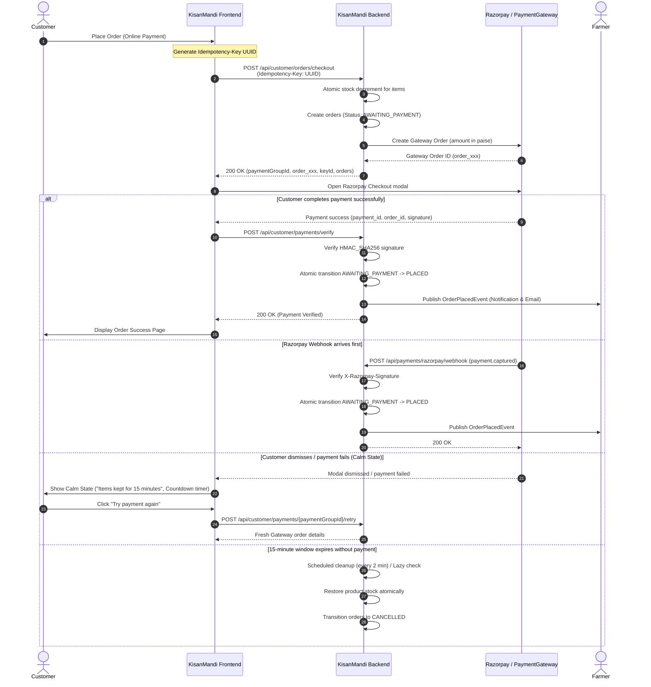

# Online Payments Architecture & Razorpay Test Mode

## 1. Overview & Core Decisions

KisanMandi supports two checkout modes:
1. **Cash on Delivery (COD)**: Orders transition directly to `PLACED`. Cash collection happens at doorstep delivery.
2. **Online Payment (Razorpay Test Mode)**: Orders start in `AWAITING_PAYMENT`. Stock is reserved immediately. Once payment is verified (via client verify endpoint or webhook), orders transition to `PLACED` and farmers are notified.

### Key Architectural Decisions
- **One Payment per Checkout Group**: When a customer checks out with items from multiple farmers, the backend creates one order per farmer but groups them under a single `payment_group_id`. A single Razorpay order covers the total sum of all farmer orders in paise.
- **Stock Reservation & Expiry Window**: Stock is decremented atomically upon checkout. If payment is not completed within 15 minutes (`app.payment.window-minutes=15`), scheduled background tasks and lazy checks release the reserved stock and cancel the orders.
- **Dual Verification Paths (Race-Free)**: Both the customer-facing `/api/customer/payments/verify` endpoint and the backend webhook `/api/payments/razorpay/webhook` can transition orders from `AWAITING_PAYMENT` to `PLACED`. An atomic SQL compare-and-swap (`UPDATE orders SET status = 'PLACED' WHERE id = :id AND status = 'AWAITING_PAYMENT'`) ensures status history and domain events (`OrderPlacedEvent`) are triggered exactly once.
- **Late Payment Refund Flagging**: If a payment arrives after the 15-minute window (when orders were already cancelled and stock released), the payment status is marked `PAID` and orders are tagged with `refund_status = 'REQUIRED'` for admin refund processing.
- **Farmer Privacy & Protection**: Farmers are NEVER exposed to `AWAITING_PAYMENT` orders. Farmers only see orders that are confirmed (`PLACED`, `ACCEPTED`, etc.). Farmer stats count only pending cash from COD orders.
- **Strict Test Mode Guard**: The application strictly refuses to start if live Razorpay keys (`rzp_live_`) are detected in production or development environments.

---

## 2. Mermaid Sequence Diagram



---

## 3. Configuration & Environment Variables

| Variable | Description | Example / Default |
|---|---|---|
| `RAZORPAY_KEY_ID` | Razorpay Test Key ID (must start with `rzp_test_` or `fake_`) | `rzp_test_1234567890abcdef` |
| `RAZORPAY_KEY_SECRET` | Razorpay Test Key Secret | `abcdef1234567890` |
| `RAZORPAY_WEBHOOK_SECRET` | Razorpay Webhook Secret for HMAC verification | `webhook_secret_xyz123` |
| `app.payment.window-minutes` | Time window to complete payment before cancellation | `15` |
| `app.payment.enabled` | Enable/disable online payments | `true` |

### Render Production Configuration
On Render, configure:
- `RAZORPAY_KEY_ID`: `rzp_test_...`
- `RAZORPAY_KEY_SECRET`: `...`
- `RAZORPAY_WEBHOOK_SECRET`: `...`

Webhook endpoint on Render:
`https://<your-render-app-url>/api/payments/razorpay/webhook`

In the Razorpay Dashboard -> Settings -> Webhooks:
- **Webhook URL**: `https://<your-render-app-url>/api/payments/razorpay/webhook`
- **Secret**: Match `RAZORPAY_WEBHOOK_SECRET`
- **Alert Email**: Your dev/admin email
- **Active Events**: `payment.captured`, `payment.failed`, `order.paid`

---

## 4. Test Payment Methods (Razorpay Test Mode)

| Method | Test Details |
|---|---|
| **Test Cards** | Card Number: `4111 1111 1111 1111`<br/>Expiry: Any future date (e.g. `12/30`)<br/>CVV: Any 3 digits (e.g. `123`)<br/>OTP: Any 4-6 digits (e.g. `123456`) |
| **UPI Success** | VPA / ID: `success@razorpay` |
| **UPI Failure** | VPA / ID: `failure@razorpay` |
| **NetBanking** | Select any test bank (e.g. SBI, HDFC) and click "Success" in the mock bank portal |

---

## 5. Webhook Simulation

To test webhooks locally without public tunneling (ngrok), use the PowerShell simulation script:

```powershell
.\scripts\simulate-razorpay-webhook.ps1 -OrderId "order_test_123" -PaymentId "pay_test_456" -AmountPaise 10000
```
This script computes the valid HMAC-SHA256 signature using `RAZORPAY_WEBHOOK_SECRET` and sends the webhook payload to `http://localhost:8080/api/payments/razorpay/webhook`.

